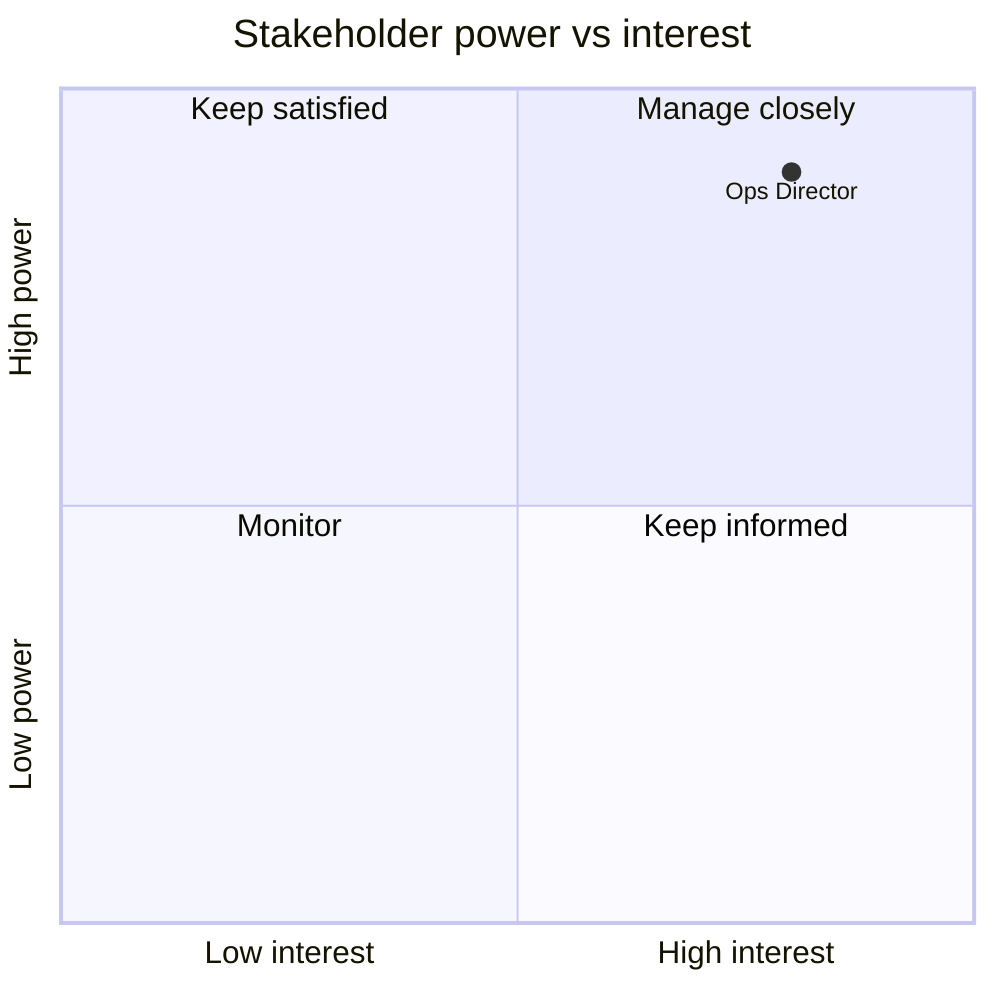

# Stakeholder map and engagement plan

## Purpose
Show who matters, how much, and how to engage them.

## Inputs
context.md › Stakeholders; interview notes in inputs/; any conflicts flagged in 04-requirements (SR-) or 03-gap.

## Structure
1. **Stakeholder register**: name/role, group, interest in the change, influence, current attitude (champion / supporter / neutral / sceptic / blocker), desired attitude, key concerns.
2. **Power/interest grid**: Mermaid `quadrantChart` (x = interest, y = power): Manage closely (high/high), Keep satisfied (high power, low interest), Keep informed (low power, high interest), Monitor (low/low).
3. **Engagement plan**: for each stakeholder/group — approach, channel, frequency, owner, next action.
4. **Conflicts and risks**: where stakeholders' needs collide, and the plan to resolve.

## Format

## Quality checks
- Every stakeholder in context.md appears; anyone with blocker/sceptic attitude has a plan.

## Technique note
Mendelow's power/interest grid decides *how much* attention each stakeholder gets; the attitude gap (current vs desired) decides *what kind*.
