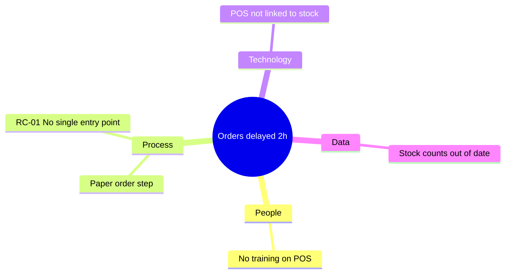

# Fishbone (Ishikawa) diagram

## Purpose
Show all contributing causes of the main problem in one picture, grouped by dimension.

## How to write
- One diagram for the single biggest problem (add more only if the user asks).
- Mermaid `mindmap`: root = the problem; first-level branches = dimension `Fishbone label`s (only those with causes); leaves = causes (short, ≤ 6 words), with `RC-` IDs for confirmed root causes.
- Below the diagram, a short list of which causes are confirmed root causes vs contributing factors.

## Format

## Technique note
The Ishikawa (fishbone) diagram prevents tunnel vision: forcing causes into several categories shows the problem is rarely just "the system" or just "the people".
