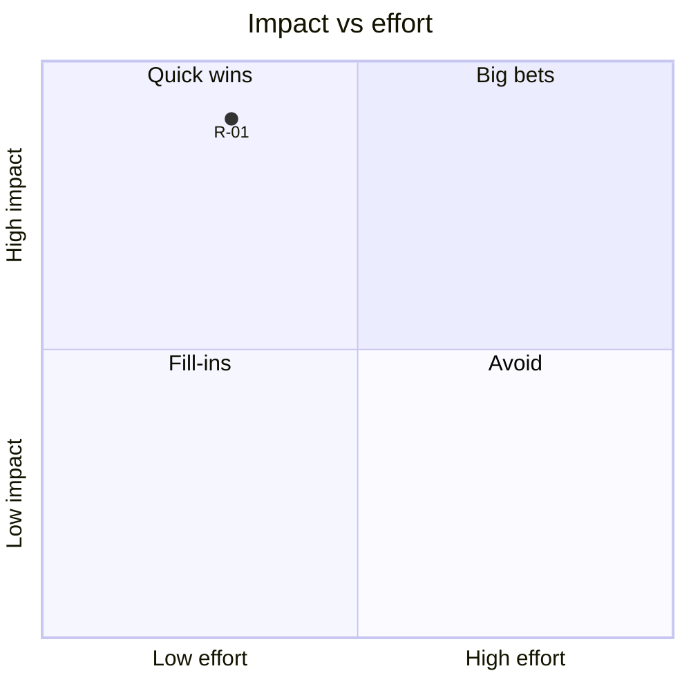

# Recommendations

## Purpose
Turn root causes and gaps into a prioritised set of actions.

## How to write
- One row per recommendation, each linked to the RC/G IDs it addresses.
- Impact (on goals) and effort (cost, time, disruption): 1–5 each, with a one-line justification.
- Category: ⚡ Quick win (high impact, low effort) · 🎯 Big bet (high impact, high effort) · 🧩 Fill-in (low impact, low effort) · ⛔ Avoid / park (low impact, high effort).
- Note dependencies, risks, and the KPI that will show it worked (baseline → target).
- Then a Mermaid `quadrantChart` plotting the recommendations (impact = y, effort = x, scaled 0–1).

## Format
| ID | Recommendation | Addresses | Impact | Effort | Category | KPI | Risks / dependencies |
|---|---|---|---|---|---|---|---|
| R-01 | Capture orders once at source | RC-01, G-01 | 5 – removes main delay | 2 – training + config | ⚡ | Order delay 2 h → 15 min | Needs POS access for all staff |

## Technique note
An impact/effort matrix makes prioritisation discussable. Scores are judgements — show the reasoning so stakeholders can challenge it.
