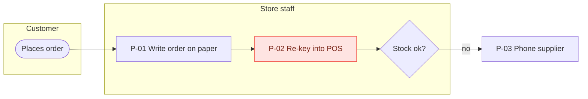

# As-is process map

## Purpose
Show how the process really works today, who does each step, and where it goes wrong.

## How to write
- Mermaid `flowchart LR` with one `subgraph` per lane (role, team, or system) to act as swimlanes.
- Nodes: `P-01 verb + object` (e.g. "P-03 Re-key order"). Start/end as rounded nodes `([ ])`, decisions as `{ }`.
- Show exception paths and rework loops — they're usually the point.
- Dashed edges (`-.->`) for manual handoffs (email, phone, paper, re-keying).
- Highlight problem steps with `classDef pain fill:#fee4e2,stroke:#f04438,color:#7a271a` and add a legend.
- **Readability limits (hard):** max **12 nodes per diagram**; node labels ≤ 5 words; edge labels ≤ 3 words.
- If the process has more than 12 steps: **2a Overview** with 4–7 phase nodes (e.g. Count → Order → Re-key → Pick → Deliver → Receive), coloured red if the phase contains a pain step; then **2b, 2c… one detailed swimlane per phase** that has pain steps (≤ 12 nodes each). Exception paths go in the phase where they start.
- Use `flowchart TB` with lanes as subgraphs when a lane would hold more than 6 steps in a row.

## Format

Legend: red = pain point · dashed = manual handoff

## Technique note
Swimlane diagrams make handoffs visible: every time the flow crosses a lane, ownership changes — and that's where delays and errors cluster.
