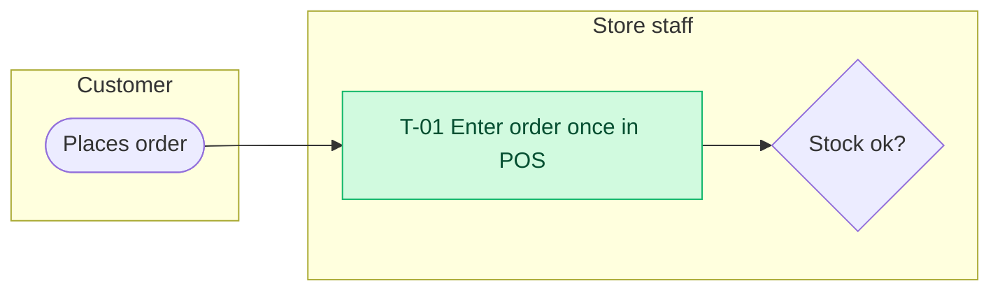

# To-be process map

## Purpose
Show the improved process, in the same style as the as-is so they can be compared side by side.

## How to write
- Same lanes and notation as the as-is map; `T-01…` step IDs.
- Highlight new or changed steps with `classDef changed fill:#d1fadf,stroke:#12b76a,color:#054f31`.
- Must respect constraints in context.md; flag any assumption the design depends on.

## Format

Legend: green = new or changed step

## Technique note
Keep the to-be at the same level of detail as the as-is. A vague to-be hides the hard decisions.
