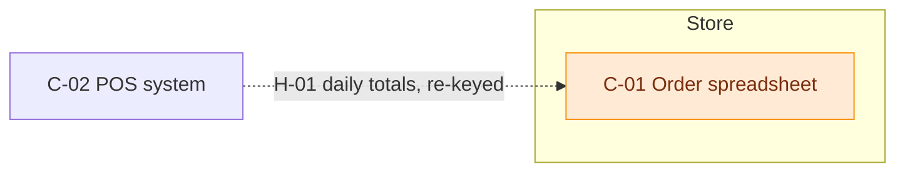

# System map diagram

## Purpose
Show the whole current system on one page, colour-coded by rating.

## How to write
- Mermaid `flowchart LR`. Nodes = components (label: `C-01 Name`); edges = handoffs (label: `H-01 what moves, how`).
- Use `subgraph` per team, location, or layer (people / tools / external) — whichever reads most clearly.
- Dashed edges (`-.->`) for manual handoffs (email, phone, re-keying); solid for automated.
- Apply the `classDef` colours from rating-scale.md and add a legend line under the diagram.
- Keep to ~25 nodes. If larger, draw one overview plus one diagram per area.

## Format

Legend: 🟢 solid · 🟠 too loose · 🟡 can be improved · 🔴 needs more work · dashed = manual

## Technique note
A colour-coded system context diagram turns an assessment into something stakeholders grasp in seconds — the "heat" shows where to look first.
