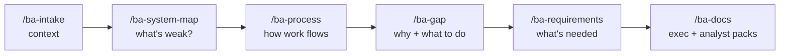

# BA Toolkit

**Turn Claude Code into a Business Analyst's co-pilot.**
Six slash-command skills take you from first interview to board-ready documents: understand the business, map the current system, analyse processes, find root causes, write requirements, and present the case.

Built for analysts improving how a company works — and for anyone learning BA, with optional *technique notes* that explain each method as it's used.



---

## Contents
- [Features](#features)
- [Requirements](#requirements)
- [Installation](#installation)
- [Quick start](#quick-start)
- [The skills](#the-skills)
- [Sample case](#sample-case)
- [Customising](#customising)
- [Conventions](#conventions)
- [Project structure](#project-structure)
- [Privacy](#privacy)

## Features
- **Asks before it assumes** — every skill interviews you on the gaps before drafting, and never invents company facts or money figures.
- **Evidence-based** — every finding cites its source (your answer, an input file, or `[Assumption]`).
- **Traceable end to end** — stable IDs link a weak handoff (`H-03`) → a root cause (`RC-01`) → a recommendation (`R-02`) → a requirement (`FR-07`) → a user story (`US-04`).
- **Visual** — colour-coded system maps, swimlane process maps, fishbone diagrams and impact/effort charts in Mermaid (render natively on GitHub).
- **Two audiences** — a short, decision-focused pack for senior management and a full, traceable pack for BAs.
- **Modular** — topics, criteria, lenses, sections and documents are each a separate Markdown file. Add one by dropping in a file; no code.
- **No API key** — runs on your Claude subscription through Claude Code.

## Requirements
- [Claude Code](https://docs.anthropic.com/en/docs/claude-code) (CLI, desktop app, or IDE extension)
- A Claude subscription or API access configured for Claude Code
- Optional: a Markdown viewer with Mermaid support (GitHub, VS Code, Obsidian) to see the diagrams

## Installation
```bash
git clone https://github.com/MinhDuc2006/ba-toolkit.git
cd ba-toolkit
claude
```
The skills live in `.claude/skills/`, so they're available whenever Claude Code is started inside this folder.

**Use them from any folder (optional):**
```bash
cp -r .claude/skills/ba-* ~/.claude/skills/
```
Then also copy the rules from `CLAUDE.md` into your project's or your global `~/.claude/CLAUDE.md`.

## Quick start
```bash
mkdir -p projects/acme/inputs
# put interview notes, meeting transcripts, process docs, data exports into projects/acme/inputs/
claude
```
Then in Claude Code:
```
/ba-intake projects/acme
/ba-system-map projects/acme
/ba-process projects/acme order-to-delivery
/ba-gap projects/acme
/ba-requirements projects/acme
/ba-docs projects/acme both
```
Every deliverable is written to `projects/acme/outputs/`.

**Short on time?** Add `--no-questions` to any skill to skip the interview: it works from what's in `context.md` and `inputs/`, marks gaps as `TBD`, and lists the questions it would have asked under *Open questions*.

## The skills

| Skill | Output | What you get |
|---|---|---|
| `/ba-intake` | `context.md` | Topic-by-topic interview: company, goals & success, stakeholders, systems, processes, pain points, data, constraints, scope. Pre-fills from your input files. |
| `/ba-system-map` | `01-system-map.md` | Inventory of every component and handoff, colour-coded map, health table against 9 criteria, and focus lists: 🟠 too loose · 🟡 can be improved · 🔴 needs more work · 🟢 solid. |
| `/ba-process` | `02-process-<name>.md` | SIPOC scope, as-is swimlane, step table (touch vs wait time), waste & bottleneck, metrics, to-be swimlane, change list with ⚡ quick wins. |
| `/ba-gap` | `03-gap.md` | Current vs target gaps by dimension, 5 Whys, fishbone, SWOT, recommendations on an impact/effort chart, Now/Next/Later roadmap. |
| `/ba-requirements` | `04-requirements.md` | Business, stakeholder, functional and non-functional requirements, user stories (INVEST), Given/When/Then acceptance criteria, MoSCoW, traceability matrix. |
| `/ba-docs` | `05-exec-*`, `06-analyst-*` | Two packs — see below. |

### `/ba-docs` packs
```
/ba-docs projects/acme exec      # for your higher-ups
/ba-docs projects/acme analyst   # for you and other BAs
/ba-docs projects/acme both
```

| Exec pack — short, plain language, answer first | Analyst pack — full detail, IDs, evidence |
|---|---|
| Executive summary (one page) | Engagement overview — start here |
| Business case (do-nothing vs options, cost/benefit, payback) | Business Requirements Document (BRD) |
| Roadmap & decisions needed | Stakeholder map (power/interest) & engagement plan |
| Slide outline (action titles + speaker notes) | RACI matrix |
| | Assumptions, decisions & open questions register |
| | Glossary & ID index |

### Useful arguments
| Example | Effect |
|---|---|
| `/ba-intake projects/acme stakeholders pain-points` | Run only those intake topics |
| `/ba-requirements projects/acme user-stories` | Regenerate only one section; other sections and IDs stay put |
| `/ba-docs projects/acme exec business-case` | Only the business case |
| `... --no-questions` | Skip the interview; record questions as open items |
| say "no notes" | Leave out the technique notes (or set `learning_mode: off` in `context.md`) |

## Sample case
`samples/coffee-chain/` is a fictional engagement — a 12-store coffee chain whose stock ordering runs on paper, spreadsheets and email. It contains realistic interview notes and data in `inputs/` and the full set of generated deliverables in `outputs/`, so you can see what each skill produces before using it on real work.

Try it yourself by copying the inputs to a new folder and running the skills:
```bash
mkdir -p projects/practice && cp -r samples/coffee-chain/inputs projects/practice/
```

## Customising
Everything that shapes a skill's questions or output is a Markdown file. Add a numbered file to the folder and the skill picks it up automatically.

| To change… | Edit / add a file in |
|---|---|
| Intake interview topics | `.claude/skills/ba-intake/topics/` |
| What the system-map ratings mean | `.claude/skills/ba-system-map/rating-scale.md` |
| System-map assessment criteria | `.claude/skills/ba-system-map/criteria/` |
| Process improvement methods | `.claude/skills/ba-process/lenses/` |
| Gap / fishbone dimensions | `.claude/skills/ba-gap/dimensions/` |
| Sections of any document | `.claude/skills/<skill>/sections/` |
| Exec / analyst writing style | `.claude/skills/ba-docs/audiences/` |
| Documents in a pack, or a new audience | `.claude/skills/ba-docs/documents/<audience>/` |
| The BA persona and shared rules | `CLAUDE.md` |

Each folder's existing files show the format to copy.

## Conventions
**Engagement folder**
```
projects/<engagement>/
├── context.md   # built by /ba-intake, read by every other skill
├── inputs/      # your raw material — never modified by the skills
└── outputs/     # deliverables
```

**ID prefixes**
| Prefix | Meaning | Prefix | Meaning |
|---|---|---|---|
| `C-` | System component | `BR-` | Business requirement |
| `H-` | Handoff / data flow | `SR-` | Stakeholder requirement |
| `P-` | As-is process step | `FR-` | Functional requirement |
| `T-` | To-be process step | `NFR-` | Non-functional requirement |
| `CH-` | Process change | `US-` | User story |
| `G-` | Gap | `A-` | Assumption |
| `RC-` | Root cause | `D-` | Decision |
| `R-` | Recommendation | `Q-` | Open question |

## Project structure
```
ba-toolkit/
├── CLAUDE.md                  # BA persona, shared rules, output conventions
├── README.md
├── .claude/skills/
│   ├── ba-intake/             # SKILL.md, context-template.md, topics/
│   ├── ba-system-map/         # SKILL.md, rating-scale.md, criteria/, sections/
│   ├── ba-process/            # SKILL.md, lenses/, sections/
│   ├── ba-gap/                # SKILL.md, dimensions/, sections/
│   ├── ba-requirements/       # SKILL.md, sections/
│   └── ba-docs/               # SKILL.md, audiences/, documents/exec|analyst/
├── projects/                  # your real engagements (git-ignored)
└── samples/coffee-chain/      # fictional worked example
```

## Privacy
`projects/` is git-ignored so real company material isn't pushed by accident. Keep client data there; only commit fictional or anonymised cases under `samples/`.
