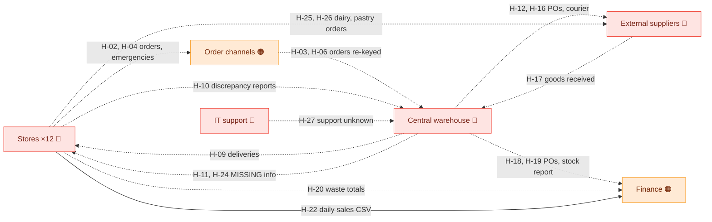
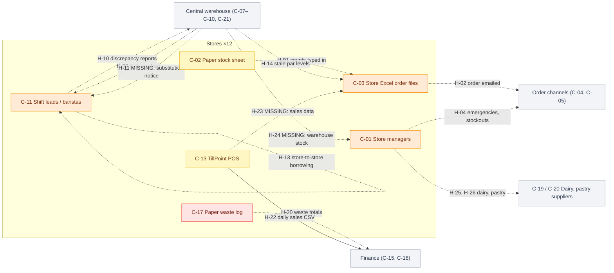
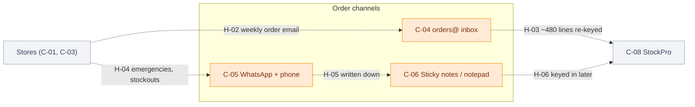
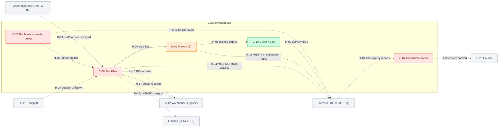
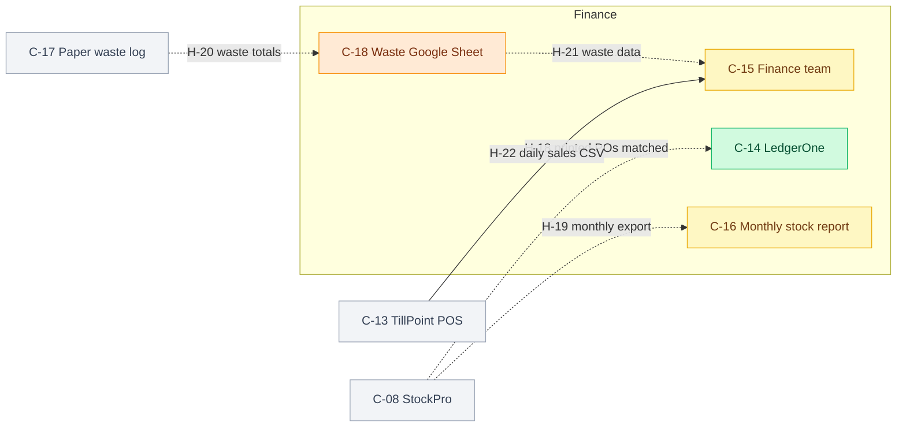
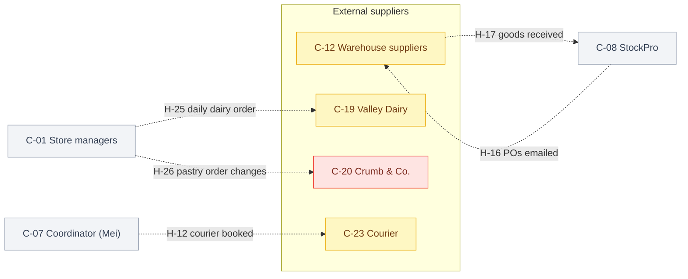

# System map — Stock ordering (current state)

- **Engagement:** Harbour Lane Coffee Co. — Stock ordering review (`samples/coffee-chain`)
- **Date:** 2026-11-12
- **Mode:** `--no-questions`. Built only from `context.md` and `inputs/`. Nothing was confirmed with the user. Missing facts are marked `TBD`, and every question I would have asked is listed under **Open questions**.
- **Sources used:** `context.md`, `inputs/01-kickoff-meeting-notes.md`, `inputs/02-interview-store-manager.md`, `inputs/03-interview-warehouse-coordinator.md`, `inputs/04-interview-finance.md`, `inputs/05-ops-data-summary.md`
- **Method:** each part was rated against the 9 criteria in the toolkit's assessment criteria (ownership, integration and handoffs, data quality, controls and rules, usability and workarounds, reliability and capacity, documentation and knowledge, security and access, cost and value). Ratings use the toolkit's four-point scale.
- **Open questions:** 12. See the end of the document. The biggest ones are: who owns TillPoint and StockPro support, how other stores differ from Docklands, and the StockPro upgrade path.

**Scope note.** "System" here means everything that moves stock information and stock around: software, spreadsheets, paper, chat, people and outside suppliers. Dairy (Valley Dairy), pastries (Crumb & Co.), waste recording and invoice matching are mapped because they affect stock and waste, but it is still `TBD` whether they are in scope (context.md › Scope).

**At a glance:** 23 components and 27 handoffs.

| Rating | Components | Handoffs |
|---|---|---|
| 🟢 Solid | 2 | 3 |
| 🟠 Too loose | 8 | 9 |
| 🟡 Can be improved | 7 | 8 |
| 🔴 Needs more work | 6 | 7 |

---

## 1. Component inventory

| ID | Component | Type | Purpose | Owner | Users | Source |
|---|---|---|---|---|---|---|
| C-01 | Store managers (×12) | Team / role | Count stock, decide order quantities, order dairy, chase problems | Each store manager. Reporting line TBD | Store managers | context.md › Stakeholders; inputs/02 |
| C-02 | Paper stock sheet + clipboard | Paper form | Sunday-night stock count (~1–1.5 h) | Store manager | Store managers | inputs/02 |
| C-03 | Store Excel order files (×12) | Spreadsheet (one per store, on the store laptop) | Turn counts into a weekly order | Each store manager | Store managers; Mei reads them | inputs/02, 03 |
| C-04 | orders@ email inbox | Shared inbox | Receive weekly store orders | Warehouse [Assumption] | Stores, Mei | inputs/02, 03 |
| C-05 | WhatsApp group + phone calls | Informal channel (workaround) | Emergency orders, late-order notices, stockout and error reports | No one | Managers, Mei | inputs/02, 03, 05 |
| C-06 | Mei's sticky notes / notepad | Workaround | Hold phone and WhatsApp orders until they are typed into StockPro | Mei | Mei | inputs/03 |
| C-07 | Warehouse & Purchasing Coordinator (Mei Chen) | Role (one person) | Re-key orders, set reorder points, raise POs (purchase orders), book couriers, export reports | Mei | — | inputs/03 |
| C-08 | StockPro | Software (warehouse inventory, ~9 yrs old) | Warehouse stock, POs, pick lists, goods received | Warehouse (Mei) [Assumption] | Warehouse staff (one shared login) | inputs/03 |
| C-09 | Pickers (2) | Team | Pick and pack store orders; substitute short-shipped items | Mei [Assumption] | — | inputs/03 |
| C-10 | Driver + van (2 routes) | Team / asset | Deliver store orders Wed/Thu | Mei [Assumption] | — | inputs/03 |
| C-11 | Store shift leads / baristas | Team | Receive and check deliveries; borrow stock from other stores | Store manager [Assumption] | — | inputs/02 |
| C-12 | Warehouse suppliers | External party | Supply beans, cups, lids, syrups, plant milks, snacks, cleaning products | Mei (as buyer) | — | inputs/01, 03 |
| C-13 | TillPoint POS | Software (point-of-sale / till) | Record sales by product; daily CSV export | **TBD** | Stores, Finance | inputs/02, 04 |
| C-14 | LedgerOne | Software (accounting) | Accounts; supplier invoice matching | Finance | Finance, accounts assistant | inputs/01, 04 |
| C-15 | Finance team (Tom Reyes + accounts assistant) | Team | Waste write-offs, invoice matching, revenue and stock reporting | Tom Reyes | — | inputs/04 |
| C-16 | Monthly stock report (Excel) | Spreadsheet | Warehouse stock position for Finance | Mei produces; Finance uses | Finance | inputs/03 |
| C-17 | Paper waste log | Paper form | Record binned or expired stock in store | Store manager | Store staff | inputs/04 |
| C-18 | Waste Google Sheet | Spreadsheet (cloud) | Monthly waste totals per store | Split: stores fill it, Finance uses it | Managers, Finance | inputs/04 |
| C-19 | Valley Dairy (daily direct order) | External party | Fresh dairy milk, ordered daily by phone or web form | Store manager (as buyer) | Store managers | inputs/01, 02 |
| C-20 | Crumb & Co. (standing pastry order) | External party | Daily pastry delivery on a fixed standing order | **TBD** (who reviews it is unclear) | Store managers | inputs/01, 02 |
| C-21 | Stock rules: par levels and reorder points | Business rules / data | Par levels (target stock per store) in Excel; reorder points (when the warehouse reorders) in StockPro | Par levels: no one. Reorder points: Mei | Managers, Mei | inputs/02, 03 |
| C-22 | IT support (Josh + on-call contractor) | Team | General IT support | Josh | Whole business | inputs/01 |
| C-23 | Courier service | External party | Emergency mid-week deliveries (~$85 each) | Mei books it | Mei | inputs/03, 04, 05 |

> **Documented vs actual.**
> - The store Excel files have a par-level column, but managers order "by guess" because the par levels are out of date (inputs/02).
> - The 10am Monday deadline exists, but it is missed about 2.4 times a week and nothing happens when it is (inputs/05).
> - Deliveries are supposed to be checked, but this happens only "if they're not slammed" (inputs/02).

---

## 2. System map diagram

The map has two levels so each picture stays readable. **2a** shows the whole system as six groups. **2b** zooms into each group that has problems. Full details of every flow are in the handoff table (section 3).

### 2a. Overview

Each group is coloured by its worst-rated component.

Legend: 🟢 solid · 🟠 too loose · 🟡 can be improved · 🔴 needs more work · dashed = manual · solid line = system-generated · "MISSING" = a flow people need that does not exist today

| Group | Components | Worst rating (driver) |
|---|---|---|
| Stores ×12 | C-01, C-02, C-03, C-11, C-13, C-17 | 🔴 C-17 paper waste log |
| Order channels | C-04, C-05, C-06 | 🟠 all three |
| Central warehouse | C-07, C-08, C-09, C-10, C-21 | 🔴 C-07 Mei, C-08 StockPro, C-21 stock rules |
| Finance | C-14, C-15, C-16, C-18 | 🟠 C-18 waste Google Sheet |
| External suppliers | C-12, C-19, C-20, C-23 | 🔴 C-20 Crumb & Co. standing order |
| IT support | C-22 | 🔴 unknown, needs investigation |

**How to read it:**
- Only one flow between groups is system-generated (H-22). Everything else moves by email, chat, paper or re-keying.
- The order loop runs Stores → Order channels → Warehouse → Stores. Every step is manual, and two flows on the way back are missing: substitution notices (H-11) and warehouse stock visibility (H-24).
- No group is all 🟢, so every group gets a detail diagram below except IT support, which has only one component.

### 2b. Detail by group

Grey nodes are neighbours from other groups, shown for context only.

#### Stores ×12 🔴

Legend: 🟢 solid · 🟠 too loose · 🟡 can be improved · 🔴 needs more work · grey = neighbour · dashed = manual · solid line = system-generated

- All three MISSING flows end here. TillPoint (C-13) already holds reliable sales data, but it goes only to Finance and never reaches the order file (H-23).

#### Order channels 🟠

Legend: 🟢 solid · 🟠 too loose · 🟡 can be improved · 🔴 needs more work · grey = neighbour · dashed = manual

- Both routes into StockPro end with Mei re-keying by hand (H-03 is rated 🔴, see section 3). Nothing in this group is tracked or acknowledged.

#### Central warehouse 🔴

Legend: 🟢 solid · 🟠 too loose · 🟡 can be improved · 🔴 needs more work · grey = neighbour · dashed = manual · solid line = system-generated

- StockPro (C-08) is the hub. It touches 8 of the 14 flows here, and only one of them (H-07) is system-generated.
- Mei (C-07) re-keys the orders (H-03, H-06), sets the reorder points (H-15), handles discrepancy reports (H-10) and books couriers (H-12). This is why ordering "fell apart" when she was off sick.

#### Finance 🟠

Legend: 🟢 solid · 🟠 too loose · 🟡 can be improved · 🔴 needs more work · grey = neighbour · dashed = manual · solid line = system-generated

- LedgerOne (C-14) is solid and should be protected. The weak point is waste data, which arrives incomplete through C-18.

#### External suppliers 🔴

Legend: 🟢 solid · 🟠 too loose · 🟡 can be improved · 🔴 needs more work · grey = neighbour · dashed = manual

- The red item is the Crumb & Co. standing order (C-20, H-26). It is changed about twice a year even though demand changes daily, and pastry waste is about $96k a year.

#### IT support 🔴 (no detail diagram)

IT support has one component (C-22) and one flow (H-27), and the overview already shows both, so a detail diagram would add nothing. How IT supports StockPro and TillPoint is unknown (see Q-02).

---

## 3. Handoffs and data flows

| ID | From → To | What moves | Mode | Frequency / volume | Rating | Issue | Source |
|---|---|---|---|---|---|---|---|
| H-01 | C-02 → C-03 | Stock counts | Manual typing (same person) | Weekly, Monday | 🟡 | Counts are written on paper and then typed again. Error rate unknown. | inputs/02 |
| H-02 | C-03 → C-04 | Weekly store order (Excel attachment) | Manual email | Weekly, 12 files, 10am Monday deadline | 🟠 | Late about 2.4 times a week ("I text Mei and hope"). Stores get no confirmation that the order arrived. 12 different file layouts. | inputs/02, 05 |
| H-03 | C-04 → C-08 | ~40 order lines per store | **Manual re-keying** by Mei | Weekly, ~480 lines, 6–8 h | 🔴 | 31 order errors in 12 weeks (e.g. "100 lids instead of 10"). Depends on one person; failed in August. StockPro's CSV import exists but is not set up. | inputs/03, 05 |
| H-04 | C-01 → C-05 | Emergency orders, stockout reports, error reports | Phone / WhatsApp | ~4.3 emergencies, ~4.5 stockouts and ~2.6 errors a week | 🟠 | Not tracked. This chat is the only record of stockouts, and they are likely under-reported. | inputs/02, 03, 05 |
| H-05 | C-05 → C-06 | Emergency orders | Handwritten | ~4.3/wk | 🟠 | Paper notes with no tracking. They can be lost, and they are invisible if Mei is away. | inputs/03 |
| H-06 | C-06 → C-08 | Emergency orders | Manual re-keying | Ad hoc, "when I get a minute" | 🟠 | Delayed entry means StockPro stock levels are wrong in the meantime [Assumption]. | inputs/03 |
| H-07 | C-08 → C-09 | Pick lists | System-generated, printed | Weekly, Tuesday | 🟢 | No issues reported. Pick lists are only as accurate as what was re-keyed in H-03. | inputs/03 |
| H-08 | C-09 → C-10 | Packed store orders | Manual | Wed/Thu | 🟢 | No issues reported. Capacity for 17 stores is TBD. | inputs/03 |
| H-09 | C-10 → C-11 | Delivery to store | Physical drop | Weekly, Wed/Thu | 🟠 | Stores get no notice of what is coming. Deliveries are often not checked against the order. | inputs/02 |
| H-10 | C-11 → C-07 | Wrong-item / wrong-quantity complaints | Email / WhatsApp | ~10 a month | 🟠 | No log or root-cause follow-up. When stock goes missing, "nobody is accountable". | inputs/03, 04 |
| H-11 | C-09 → C-11 | Substitution notice | **Missing** | 11 unannounced substitutions in 12 weeks | 🔴 | Pickers substitute "the closest thing" and nobody tells the store. There is no rule or process for this. | inputs/02, 03, 05 |
| H-12 | C-07 → C-23 | Emergency delivery booking | Manual | ~4.3/wk at ~$85 | 🟡 | The booking itself works, but couriers cost about $19k a year. This is a symptom of stockouts. | inputs/03, 04, 05 |
| H-13 | C-11 → other stores | Borrowed stock | Informal, untracked | "Most weeks in summer" | 🟠 | Stock moves between stores with no record, which distorts counts and waste figures [Assumption]. Costs barista time. | inputs/02 |
| H-14 | C-21 → C-03 | Par levels for sizing orders | Manual (column ignored) | Weekly | 🔴 | Par levels have not been updated since 2024, so managers order "by guess". | inputs/02 |
| H-15 | C-21 → C-08 | Reorder points | Manual, set by Mei "from experience" | Ad hoc | 🟠 | The logic is not written down and nobody else knows it. | inputs/03 |
| H-16 | C-08 → C-12 | Purchase orders | Manual email (PDF) | Weekly, Tuesday | 🟡 | Works, but it is a manual step. | inputs/03 |
| H-17 | C-12 → C-08 | Goods received | Manual typing | Weekly, Friday | 🟡 | Works [limited evidence]. How short-shipments are recorded is TBD. | inputs/03 |
| H-18 | C-08 → C-14 (via C-15) | POs for invoice matching | Printouts matched by hand | Monthly, ~2 days of the accounts assistant's time | 🟡 | Reliable but slow. Error rate unknown. | inputs/04 |
| H-19 | C-08 → C-16 | Warehouse stock position | Manual export to Excel | Monthly | 🟡 | Report built by hand, and only Mei produces it [Assumption]. | inputs/03 |
| H-20 | C-17 → C-18 | Waste totals | Manual typing | Monthly; only ~8 of 12 stores do it properly | 🟠 | Incomplete, with no check or chase. | inputs/04 |
| H-21 | C-18 → C-15 | Waste data | Shared sheet | Monthly | 🟡 | The handoff works, but the data arrives incomplete (see C-17). | inputs/04 |
| H-22 | C-13 → C-15 | Daily sales by product | Automated CSV export | Daily | 🟢 | Reliable. Used for revenue reporting only. | inputs/04 |
| H-23 | C-13 → C-03 | Sales data to inform orders | **Missing** | — | 🔴 | Reliable sales data exists but is not used for ordering: "If the till knows what we sold, why am I counting everything by hand?" | inputs/02, 04 |
| H-24 | C-08 → C-01 | Warehouse stock levels | **Missing** | — | 🔴 | Stores cannot see warehouse stock, so they over-order "just in case". Stock then sits in back rooms while the warehouse runs out. | inputs/02, 03 |
| H-25 | C-01 → C-19 | Daily dairy order | Phone / web form | Daily | 🟡 | Manual every day. No problems reported [limited evidence]. Scope TBD. | inputs/02 |
| H-26 | C-01 → C-20 | Changes to the standing pastry order | Manual email | "Maybe twice a year" | 🔴 | Not adjusted for seasonal trade. 15–20 pastries are binned per weekday at Docklands; pastry waste is about $96k a year chain-wide. | inputs/02, 04 |
| H-27 | C-22 → C-08 | Support and fixes | Unknown | Unknown | 🔴 | Unknown, needs investigation. It is not clear whether Josh, the contractor or the vendor supports StockPro. | inputs/01, 03 |

---

## 4. Health assessment

Key: 🟢 solid · 🟠 too loose · 🟡 can be improved · 🔴 needs more work · blank = not relevant or no evidence for that criterion.

### Components

| ID | Part | Ownership | Integration | Data | Controls | Usability | Reliability | Knowledge | Security | Cost | Overall | Why |
|---|---|---|---|---|---|---|---|---|---|---|---|---|
| C-01 | Store managers | 🟠 | 🟠 | 🟠 | 🟠 | 🟠 | 🟡 | 🟠 | | 🟡 | 🟠 Too loose | Every store does it differently, by guesswork; ~30–42 h a week across the chain |
| C-02 | Paper stock sheet | | 🟡 | 🟡 | | 🟡 | 🟢 | | | 🟡 | 🟡 Can be improved | Works, but takes 1–1.5 h a week and is typed again |
| C-03 | Store Excel order files | 🟠 | 🟠 | 🟠 | 🟠 | 🟠 | | 🟠 | 🟡 | 🟡 | 🟠 Too loose | 12 layouts, no validation, stale par levels, emailed around |
| C-04 | orders@ inbox | 🟡 | 🟠 | 🟠 | 🟠 | 🟡 | 🟡 | | 🟡 | | 🟠 Too loose | Untracked, no receipt confirmation, deadline not enforced |
| C-05 | WhatsApp + phone | 🟠 | 🟠 | 🟠 | 🟠 | 🟠 | 🟠 | | 🟠 | 🟡 | 🟠 Too loose | Holds emergency orders and the only stockout record, with no owner or tracking |
| C-06 | Sticky notes / notepad | 🟠 | 🟠 | 🟠 | 🟠 | 🟠 | 🟠 | 🟠 | | | 🟠 Too loose | Personal paper workaround; invisible to anyone else |
| C-07 | Coordinator (Mei) | 🟡 | 🟠 | 🟠 | 🟠 | 🟡 | 🔴 | 🔴 | | 🟡 | 🔴 Needs more work | Single point of failure: ordering failed when she was off for a week |
| C-08 | StockPro | 🟠 | 🟠 | 🟡 | 🟠 | 🟡 | 🔴 | 🟠 | 🟠 | | 🔴 Needs more work | Current version reaches end of support Dec 2027; shared login; no integrations |
| C-09 | Pickers (2) | 🟡 | | 🟠 | 🟠 | | 🟠 | 🟠 | | | 🟠 Too loose | Substitute items with no rule or notice; cover failed in August |
| C-10 | Driver + van | 🟢 | | | | | 🟢 | | | | 🟢 Solid | No issues reported. Capacity at 17 stores unconfirmed [Assumption] |
| C-11 | Shift leads / baristas | 🟠 | | 🟠 | 🟠 | 🟡 | | 🟠 | | 🟡 | 🟠 Too loose | Delivery checks skipped when busy; borrowing untracked |
| C-12 | Warehouse suppliers | 🟢 | 🟡 | 🟡 | | | 🟡 | | | | 🟡 Can be improved | Short-ships happen; supplier performance not measured (low evidence) |
| C-13 | TillPoint POS | 🟠 | 🟡 | 🟢 | | 🟡 | 🟢 | | | 🟡 | 🟡 Can be improved | Reliable data that is not used for ordering. Owner TBD (see note) |
| C-14 | LedgerOne | 🟢 | 🟡 | 🟢 | | | 🟢 | | | 🟢 | 🟢 Solid | New, owned by Finance, mandated by the board |
| C-15 | Finance team | 🟢 | 🟡 | 🟡 | 🟡 | | | | | 🟡 | 🟡 Can be improved | Controls work, but by hand (~2 days a month of matching) |
| C-16 | Monthly stock report | 🟡 | 🟡 | 🟡 | | 🟡 | 🟡 | | | | 🟡 Can be improved | Built by hand each month |
| C-17 | Paper waste log | 🟠 | 🟠 | 🔴 | 🟠 | 🟠 | | | | | 🔴 Needs more work | 4 of 12 stores incomplete, so the waste baseline is disputed |
| C-18 | Waste Google Sheet | 🟠 | 🟠 | 🟠 | 🟠 | | | | 🟡 | | 🟠 Too loose | Split ownership, manual totals, no validation |
| C-19 | Valley Dairy | | 🟡 | | | 🟡 | | | | | 🟡 Can be improved | Daily manual order. No problems reported (low evidence) |
| C-20 | Crumb & Co. standing order | 🟠 | 🟠 | 🔴 | 🟠 | | | | | 🔴 | 🔴 Needs more work | Fixed order not matched to demand; ~$96k a year of pastry waste |
| C-21 | Par levels + reorder points | 🟠 | | 🔴 | 🟠 | | 🟠 | 🔴 | | 🔴 | 🔴 Needs more work | Par levels stale since 2024; reorder logic exists only in Mei's head |
| C-22 | IT support | | | | | | 🟠 | 🔴 | | | 🔴 Needs more work | Unknown, needs investigation: its role in stock systems is not described |
| C-23 | Courier | 🟡 | | | | | 🟢 | | | 🟡 | 🟡 Can be improved | Reliable but costly (~$19k a year), driven by stockouts |

**Judgement calls**
- **C-13 TillPoint** is rated 🟡 even though Ownership is 🟠. The ownership gap is a missing fact (`TBD`), not an observed failure. The system itself is reliable, and the main finding is value that isn't being used. Re-rate it if the owner turns out to be unclear in practice.
- **C-06 Sticky notes** is rated 🟠, not 🔴. It works most of the time. Its failure mode is covered by C-07.
- **C-08 StockPro** is rated 🔴 because of end of support (Dec 2027), not daily performance. Day to day it is closer to 🟠.

### Handoffs with an issue (🟠 and 🔴)

| ID | Part | Ownership | Integration | Data | Controls | Usability | Reliability | Knowledge | Security | Cost | Overall | Why |
|---|---|---|---|---|---|---|---|---|---|---|---|---|
| H-02 | Order file emailed | 🟡 | 🟠 | 🟠 | 🟠 | | 🟡 | | | | 🟠 Too loose | 2.4 late a week, no receipt confirmation |
| H-03 | Orders re-keyed into StockPro | 🟠 | 🔴 | 🔴 | 🟠 | 🟡 | 🔴 | 🟠 | | 🟡 | 🔴 Needs more work | ~2.6 errors a week; one person; 6–8 h a week |
| H-04 | Emergency / stockout reports via chat | 🟠 | 🟠 | 🟠 | 🟠 | | | | 🟠 | | 🟠 Too loose | Untracked; stockouts under-reported |
| H-05 | Chat → sticky notes | 🟠 | 🟠 | 🟠 | 🟠 | | 🟠 | | | | 🟠 Too loose | Paper with no tracking |
| H-06 | Sticky notes → StockPro | 🟠 | 🟠 | 🟠 | | | 🟠 | | | | 🟠 Too loose | Delayed and ad hoc |
| H-09 | Delivery to store | | 🟠 | | 🟠 | | | | | | 🟠 Too loose | No advance notice; checks skipped |
| H-10 | Discrepancy reports | 🟠 | 🟠 | 🟠 | 🟠 | | | | | | 🟠 Too loose | No log; nobody accountable |
| H-11 | Substitution notice (missing) | 🟠 | 🔴 | 🟠 | 🔴 | | | 🟠 | | | 🔴 Needs more work | No rule or notice; 11 in 12 weeks; causes stockouts |
| H-13 | Store-to-store borrowing | 🟠 | 🟠 | 🟠 | 🟠 | | | | | 🟡 | 🟠 Too loose | Untracked stock movement |
| H-14 | Par levels → order | 🟠 | | 🔴 | 🟠 | 🟠 | | 🟠 | | | 🔴 Needs more work | Rule exists on paper, but is stale and ignored |
| H-15 | Reorder points → StockPro | 🟡 | | 🟡 | 🟠 | | 🟠 | 🟠 | | | 🟠 Too loose | Works, but only Mei knows how |
| H-20 | Waste log → Google Sheet | 🟠 | 🟠 | 🟠 | 🟠 | | | | | | 🟠 Too loose | Only ~8 of 12 stores |
| H-23 | Sales → ordering (missing) | | 🔴 | 🟠 | | | | | | 🟠 | 🔴 Needs more work | Reliable demand data goes unused |
| H-24 | Warehouse stock → stores (missing) | | 🔴 | 🟠 | | | | | | 🟠 | 🔴 Needs more work | Drives "just in case" over-ordering |
| H-26 | Pastry order changes | 🟠 | 🟠 | 🔴 | 🟠 | | | | | 🔴 | 🔴 Needs more work | Changed ~2×/yr against daily demand swings |
| H-27 | IT support → StockPro | | | | | | 🔴 | 🔴 | | | 🔴 Needs more work | Unknown, needs investigation |

### Evidence for 🟠 and 🔴 ratings

**Components**
- **C-01 Store managers 🟠.** "I look at what we've got and guess what we'll need" (inputs/02). They spend 2.5–3.5 h a week each (inputs/05). Across 12 stores that is ≈ 30–42 h a week, or about $59k–$83k a year at $38/h (calculated). New managers "learn from whoever trains them" (inputs/02). "If stock goes missing, nobody is accountable" (inputs/04).
- **C-03 Store Excel order files 🟠.** "I added my own columns" (inputs/02). "Each store's file is a bit different so I have to read carefully" (inputs/03). Par levels not updated since 2024 (inputs/02). Security 🟡 because the files sit on a shared store laptop [Assumption].
- **C-04 orders@ inbox 🟠.** 2.4 late emails a week (inputs/05). Orders arrive between 7am and about 11am (inputs/03). There is no acknowledgement step [Assumption: none mentioned].
- **C-05 WhatsApp + phone 🟠.** Used for emergency orders, late notices, stockout reports and error reports (inputs/02, 03, 05). Stockouts are self-reported here and "likely under-reported" (inputs/05). Mei: "they just tell me when they're angry" (inputs/03). Security 🟠: business data sits in a chat app, likely on personal phones [Assumption].
- **C-06 Sticky notes 🟠.** Orders are "written on sticky notes or a notepad, then entered when I get a minute" (inputs/03).
- **C-07 Coordinator (Mei) 🔴 — Fix.** When Mei was off sick in August, "a casual picker tried to cover and two stores got nothing for a week" (inputs/03). Re-keying takes 6–8 h a week, about $10.6k–$14.1k a year at $34/h (calculated). Ordering is meant to scale to 17 stores without a second coordinator (inputs/01).
- **C-08 StockPro 🔴 — Investigate.**
  - The current version reaches end of support in Dec 2027 (inputs/03).
  - Everyone uses one shared login, so there is no audit trail (inputs/03, 04).
  - The CSV import function "nobody has set up" (inputs/03).
  - It has no link to TillPoint or LedgerOne (inputs/03).
  - Upgrade path and running costs: TBD.
- **C-09 Pickers 🟠.** Pickers substitute "the closest thing and don't tell the store. No process for that." (inputs/03). The casual picker could not cover for Mei (inputs/03).
- **C-11 Shift leads / baristas 🟠.** Deliveries are checked only "if they're not slammed" and are "often not checked against the order" (inputs/02). Staff are sent to borrow stock from other stores (inputs/02).
- **C-17 Paper waste log 🔴 — Fix.** "Maybe 8 of 12 stores do it properly" (inputs/04). As a result the baseline is disputed: $182k recorded vs ~$250k estimated (inputs/01, 04).
- **C-18 Waste Google Sheet 🟠.** Managers type monthly totals into it, and completion is patchy (inputs/04). Its sharing and access settings are TBD.
- **C-20 Crumb & Co. 🔴 — Fix.** The standing order is changed "maybe twice a year" and "hasn't been adjusted for the quieter winter trade". "We bin maybe 15–20 pastries a day" (inputs/02). Pastry waste is about $96k a year (inputs/04).
- **C-21 Par levels + reorder points 🔴 — Fix.** "Nobody's updated those since 2024" (inputs/02). Reorder points are set "from experience. Nobody else knows how they're set." (inputs/03). These rules are a likely driver of both stockouts and waste [Assumption, to test in /ba-gap].
- **C-22 IT support 🔴 — Investigate.** The sources only say there is one generalist plus an on-call contractor (inputs/01). How they support StockPro, TillPoint and access management is not described anywhere.

**Handoffs**
- **H-02 🟠** inputs/02, 05 (late emails; "text Mei and hope").
- **H-03 🔴** inputs/03, 05 (31 errors in 12 weeks; 6–8 h; the August failure).
- **H-04, H-05, H-06 🟠** inputs/02, 03, 05.
- **H-09, H-10 🟠** inputs/02, 03 (~10 wrong-item emails a month), inputs/04 (accountability).
- **H-11 🔴** inputs/02 ("ordered 16oz cups, got 12oz — no one told us"), inputs/03, inputs/05 (11 in 12 weeks).
- **H-13 🟠** inputs/02.
- **H-14 🔴** inputs/02.
- **H-15 🟠** inputs/03.
- **H-20 🟠** inputs/04.
- **H-23 🔴** inputs/02 (Daniel's idea), inputs/04 (TillPoint data is reliable but used only for revenue).
- **H-24 🔴** inputs/02, 03.
- **H-26 🔴** inputs/02, 04.
- **H-27 🔴** no evidence. Unknown, needs investigation.

---

## 5. Focus areas

⚡ = quick win (low effort, clear benefit).

### 🟠 Too loose
1. **C-03 Store Excel order files + H-02 order email.** Each of the 12 stores sends a different file to an untracked inbox. This is the input to the error-prone re-keying in H-03 and to Mei's 6–8 h Monday. *Direction:* one standard order template for all stores, with fixed product codes and basic checks (no free-text quantities). Confirm each order on receipt. A standard layout is also what is needed to use the warehouse system's existing, unused import function. ⚡
2. **C-05 WhatsApp + phone, H-04 → H-06 emergency path.** About 4.3 emergency orders a week (≈ $19k a year in couriers) and every stockout report go through untracked chat and sticky notes. There is no reliable stockout baseline for the business case. *Direction:* one shared log for emergency orders, stockouts and errors, with simple fields (store, item, date, reason). It becomes the measured baseline straight away. ⚡
3. **C-01 Store managers / store ordering practice.** About 30–42 manager hours a week (≈ $59k–$83k a year) go on counting and guessing, and every store does it differently. *Direction:* a single written store-ordering routine and a named owner for store ordering standards. Reduce manual counting as demand data comes in (see H-23).
4. **C-09 Pickers + C-11 delivery receipt (H-09, H-10).** Wrong items reach stores without being checked or traced, so "nobody is accountable". *Direction:* send a "what's coming" list to each store before delivery. Add a simple sign-off at receipt and log discrepancies. ⚡
5. **H-15 Reorder points.** Warehouse reordering depends on knowledge only Mei has. *Direction:* write down the current reorder points and the reasoning behind them, and have a second person review them. ⚡
6. **C-18 Waste Google Sheet + H-20.** Waste totals arrive incomplete with no chase, which weakens the waste baseline. *Direction:* name one owner and set a monthly completion check (see C-17).
7. **H-13 Store-to-store borrowing.** Untracked stock movement and lost barista time. *Direction:* record borrowings in the same shared log as emergencies (see item 2). ⚡
8. **C-06 Sticky notes.** Covered by item 2.

### 🟡 Can be improved
1. **C-13 TillPoint POS.** Reliable, product-level daily sales data is used only for revenue reporting. *Direction:* use sales history to suggest order quantities and par levels (see H-23). Confirm who owns it.
2. **C-15 Finance + H-18 invoice matching.** About 2 days a month spent matching invoices against printed POs. *Direction:* match against electronic POs and remove the printouts.
3. **C-23 Courier (H-12).** About $19k a year. *Direction:* courier use should fall as stockouts fall. Track it as a business-case benefit measure.
4. **C-02 Paper stock sheet + H-01.** 1–1.5 h a week per store, then typed again. *Direction:* count straight into the standard order template, or count fewer items once sales data drives orders.
5. **C-16 Monthly stock report + H-19.** Built by hand each month. *Direction:* a standard report that someone other than Mei can produce.
6. **C-12 Warehouse suppliers + H-16, H-17.** Short-shipments are not tracked. *Direction:* record short-ships at goods receipt and feed them into the substitution rule (H-11).
7. **C-19 Valley Dairy + H-25.** A daily manual order. Low evidence of problems. Check whether it is in scope before spending effort here.

### 🔴 Needs more work
1. **C-07 Coordinator (Mei) + H-03 re-keying — [Fix].** One person re-keys about 480 lines a week with about 2.6 errors a week. When she was off for a week, two stores got nothing. Without a change, 17 stores means ~680 lines a week (calculated) and still one coordinator. *Direction:* remove the manual re-keying step (standard template plus the existing import function as the first step), document her tasks, and cross-train a backup.
2. **C-20 Crumb & Co. standing order + H-26 — [Fix].** Pastries are the largest waste item at about $96k a year, about 53% of recorded waste. *Direction:* review standing orders by store and season against TillPoint sales, for example monthly. ⚡ (if pastries are confirmed in scope)
3. **C-21 Par levels and reorder points + H-14 — [Fix].** Ordering rules are stale or exist only in one person's head, which drives both stockouts and "just in case" waste. *Direction:* reset par levels using recent sales, give the rules a named owner, and set a review cycle.
4. **H-11 Substitution notice — [Build].** 11 unannounced substitutions in 12 weeks. Stores receive items they can't use and then run out. *Direction:* a substitution rule (what may be substituted, and who approves it) and a notice to the store before delivery. ⚡
5. **C-08 StockPro — [Investigate].** The current version reaches end of support in Dec 2027 and everyone shares one login. Any money spent on it could be stranded. *Direction:* find out the vendor's upgrade path and cost before committing the $60k budget. Move to individual logins now. ⚡ (logins)
6. **H-23 Sales → ordering and H-24 warehouse stock → stores (missing flows) — [Build].** Demand data and warehouse stock levels both exist but nobody sees them when ordering. *Direction:* make sales history and warehouse availability visible at the point of ordering.
7. **C-17 Paper waste log — [Fix].** Incomplete in 4 of 12 stores, which leaves the waste baseline disputed ($182k vs ~$250k). *Direction:* get all stores logging for 4–6 weeks so the business case has a defensible baseline. ⚡
8. **C-22 IT support + H-27 — [Investigate].** Unknown. Interview Josh about who supports StockPro and TillPoint, how access is managed, and how much capacity he has for the Feb–Jun 2027 delivery window.

### 🟢 Solid — protect
- **C-14 LedgerOne.** New, owned by Finance and mandated. Design around it and don't change it.
- **H-22 TillPoint daily sales export.** Reliable data. It is the foundation for demand-based ordering.
- **C-10 Driver + van routes, H-07 pick lists, H-08 packing.** No issues reported. Check capacity for 17 stores before relying on them.

---

## Open questions
All *not asked — --no-questions*.

| ID | Question | Criterion | Ask |
|---|---|---|---|
| Q-01 | Is anything missing from the parts list, e.g. other stores' own trackers, a borrowing record, or other side spreadsheets? | Usability and workarounds | Priya, store managers |
| Q-02 | Who owns TillPoint? Who supports StockPro day to day: Josh, the contractor or the vendor? (C-13, C-22, H-27) | Ownership | Priya, Josh |
| Q-03 | How do other stores' order files, counting and delivery checks differ from Docklands? (C-01, C-03, C-11) | Knowledge | 1–2 more store managers |
| Q-04 | Who has access to orders@, the WhatsApp group and the waste Google Sheet? How is access removed when staff leave? Are personal phones used? | Security and access | Josh, Mei |
| Q-05 | What upgrade path and cost has the StockPro vendor offered before Dec 2027? What format does the CSV import accept? (C-08) | Reliability | Mei, Josh |
| Q-06 | If Mei were away for a month, what would break? Is any of her work written down? (C-07, C-21) | Knowledge | Mei, Priya |
| Q-07 | How often do suppliers short-ship, and who decides what a picker may substitute? (C-12, H-11) | Controls | Mei, a picker |
| Q-08 | Can the van and 2 routes cover 17 stores? (C-10) | Reliability | Mei, driver |
| Q-09 | Who reviews the Crumb & Co. standing orders, and are pastries and dairy in scope? (C-19, C-20) | Ownership / scope | Priya |
| Q-10 | Who is accountable for stock once it reaches a store? (C-01, H-10) | Ownership | Priya, Tom |
| Q-11 | How are invoice-matching errors found today, and how often do they occur? (H-18) | Data quality | Accounts assistant |
| Q-12 | Can we get samples: 2–3 store Excel files, a StockPro reorder-point export, a TillPoint CSV? (context.md › Open questions #15) | Data quality | Mei, Josh |

## Next steps
1. **Validate this map** with Mei and one more store manager (ideally from a quieter store). Answer Q-01 to Q-03 and adjust the ratings.
2. **Run `/ba-process samples/coffee-chain weekly-replenishment`** to map the core flow (H-01 → H-11) with timings. Most of the 🟠 and 🔴 handoffs sit on it.
3. **Run `/ba-gap samples/coffee-chain`** to find root causes behind the 🔴 items, especially C-21 (stock rules) as a common cause of both stockouts and waste.
4. **Start the quick wins** that also build the baseline: the shared stockout/emergency log (C-05), complete waste logging (C-17) and individual StockPro logins (C-08). Note the change freeze from 1 Dec to 31 Jan. Logging changes are low-risk, but confirm with Priya first.
5. Run `/ba-requirements` once the target picture is agreed.

## Technique notes
- **Component inventory.** A context/inventory list is the BA's first defence against blind spots. Shadow tools are often where the real system lives. Here, WhatsApp (C-05) and sticky notes (C-06) carry every emergency order and the only stockout data.
- **System map diagram.** A colour-coded context diagram turns an assessment into something stakeholders grasp in seconds, because the colours show where to look first. Notice how many lines are dashed (manual) and how many run through C-07.
- **Handoffs and data flows.** Most process failures happen at handoffs, not inside components. Mapping them separately makes "too loose" areas obvious. It also exposes *missing* handoffs (H-11, H-23, H-24), which are easy to miss if you only list systems.
- **Health assessment.** Scoring against fixed criteria keeps the assessment fair and repeatable. It also shows *why* a part is weak, which points to the right fix. For example, StockPro is red for reliability (end of support), not usability.
- **Focus areas.** These lists feed directly into `/ba-gap` (why is it loose?) and `/ba-requirements` (what must the target state do?). Tag items by IDs so they stay traceable.
