# Process analysis — Weekly store replenishment (as-is → to-be)

- **Engagement:** Harbour Lane Coffee Co. — Stock ordering review (`samples/coffee-chain`)
- **Date:** 2026-11-12
- **Mode:** `--no-questions`. Built only from `context.md`, `inputs/` and `outputs/01-system-map.md`. The step walk-through (skill step 2) and the reaction to proposed changes (skill step 4) were **not** done with the user. Missing timings are `TBD`. Every question I would have asked is under **Open questions**.
- **Sources used:** `context.md`, `inputs/01-kickoff-meeting-notes.md`, `inputs/02-interview-store-manager.md`, `inputs/03-interview-warehouse-coordinator.md`, `inputs/04-interview-finance.md`, `inputs/05-ops-data-summary.md`, `outputs/01-system-map.md` (reuses its `C-` and `H-` IDs).
- **Lenses applied:** Lean waste (DOWNTIME), value-added analysis, ECRS, handoffs and controls.
- **Open questions:** 17. The most important: what causes the 31 order errors (Q-05), whether StockPro's import and export can do what the to-be needs (Q-10), and whether till products can be matched to warehouse items (Q-11).

**In one paragraph.** The weekly cycle takes 3–4 days from the Sunday count to the Wed/Thu delivery. That elapsed time is set by the fixed delivery schedule, not by the work itself. The real problems are effort, errors and risk. The chain spends about 36–50 hours a week on ordering paperwork, about $70k–$97k a year (calculated). All 12 orders queue behind one person who re-types them. Order quantities are guessed. Substitutions and wrong items reach stores unannounced and often unchecked. Failures spill into an untracked emergency path, which costs about $19k a year in couriers. The to-be keeps the delivery schedule and the people. It removes re-typing, puts sales and warehouse data in front of the manager when they order, and adds simple written rules and a single log at each weak handoff.

---

## 1. Process scope (SIPOC)

- **Process:** Weekly store replenishment (store → warehouse → store), including the mid-week emergency top-up, which is how this process fails.
- **Owner:** **None end-to-end.** Store managers run the store part and Mei Chen (coordinator) runs the warehouse part. Priya Nair sponsors the review. *Finding: nobody owns the whole flow, which matches Tom's "if stock goes missing, nobody is accountable" (inputs/04).*
- **Trigger:** Sunday after close, weekly (inputs/02).
- **End:** stock delivered and accepted at the store, Wed/Thu (inputs/02, 03).
- **Volume:** 12 store orders and ~480 lines a week (inputs/03). ~4.3 emergency orders a week (inputs/05). Rising to 17 stores and ~680 lines a week by July 2027 (calculated: 480 ÷ 12 × 17).

| Suppliers | Inputs | Process (high level) | Outputs | Customers |
|---|---|---|---|---|
| Store managers (C-01) | Stock counts (C-02) | 1. Count stock in store | Store stock on shelves | Store shift leads and baristas (C-11): the internal customer |
| Par levels / stock rules (C-21) | Par levels (stale since 2024) | 2. Decide quantities and send the order | Delivery (boxes) | Café customers (indirect): "customers walk out" on stockouts |
| Coordinator, Mei (C-07) | Store Excel order files (C-03) via orders@ (C-04) | 3. Enter orders into the warehouse system | Pick lists, outbound stock records in StockPro | Finance (C-15): stock records, courier costs |
| StockPro (C-08) | Warehouse stock levels | 4. Pick and pack | Emergency deliveries and borrowed stock | Warehouse purchasing (next process): outbound stock drives reorders |
| Warehouse suppliers (C-12), indirectly | Supplier short-shipments | 5. Deliver | Error and stockout reports (WhatsApp) | |
| TillPoint POS (C-13): **not used today** | Daily sales by product (H-22, available but unused) | 6. Receive and check | | |
| | | 7. Top up mid-week (exception) | | |

**Out of scope (adjacent processes):**
- **Warehouse purchasing:** reorder points, purchase orders and goods received (H-15 to H-17). It is an interface only: warehouse shortages feed the substitution step P-09.
- **Direct supplier orders:** Valley Dairy (dairy) and Crumb & Co. (pastries). Scope is `TBD` (context.md Open question #1). Pastries are about $96k of the $182k waste, so they likely need their own `/ba-process` run.
- **Waste recording, invoice matching, LedgerOne.**

---

## 2. As-is process map

The process has 17 steps, more than one diagram can show clearly (limit: 12 nodes per diagram). **2a** shows the six phases. **2b–2f** show each phase that contains a pain step, with each exception path drawn in the phase where it starts. *Deliver* (P-10) has no pain step, so it appears only as the entry point of 2e.

Legend (all diagrams): red = pain point · dashed = manual handoff (paper, email, chat, re-keying, physical) · solid = in-person or system step · rounded = start, end, or link to another diagram · `H-` = handoff ID from the system map · MISSING = a flow that should exist but doesn't.

### 2a. Overview

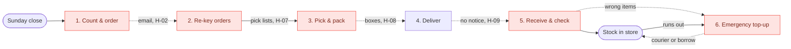

| Phase | Who | Steps | Pain steps | Detail |
|---|---|---|---|---|
| 1. Count & order | Store manager | P-01 to P-05 | P-03 | 2b |
| 2. Re-key orders | Mei, StockPro | P-06, P-07 | P-06 | 2c |
| 3. Pick & pack | Pickers | P-08, P-09 | P-09 | 2d |
| 4. Deliver | Driver | P-10 | — | entry point of 2e |
| 5. Receive & check | Shift lead | P-11, P-12 | P-11 | 2e |
| 6. Emergency top-up | Store manager, Mei, barista | P-13 to P-17 | P-13, P-14, P-17 | 2f |

### 2b. Count & order (Sunday night → Monday 10am)

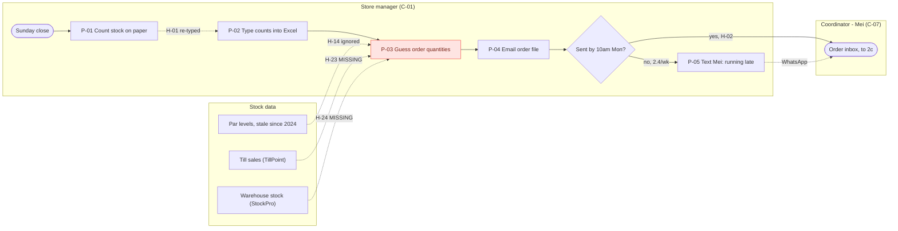
**What to notice:** the manager decides quantities while all three data sources are either stale (H-14) or missing (H-23, H-24). The same counts are written twice (P-01 → P-02). The late-order branch (≈ 20% of orders) has no rule, only a text message.

### 2c. Re-key orders (Monday → Tuesday)

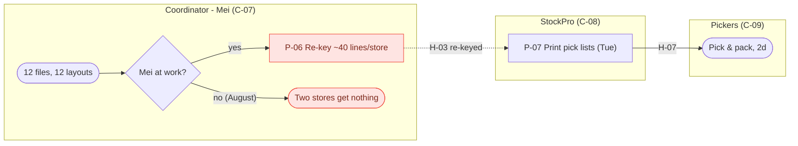
**What to notice:** every order passes through one person (6–8 h a week, 31 errors in 12 weeks). Nobody designed the "Mei at work?" branch. It shows what happened in August, when "two stores got nothing for a week" (inputs/03).

### 2d. Pick & pack (Tuesday)

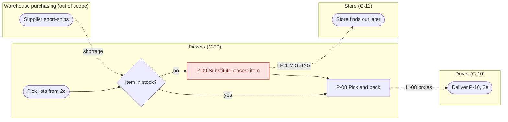
**What to notice:** there is no written rule for substitutions, and the store is never told (H-11). That is how an order for 16oz cups arrived as 12oz cups, and why cups are the #2 stockout item.

### 2e. Receive & check (Wednesday/Thursday)

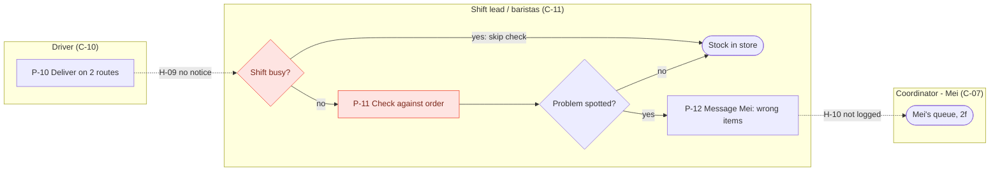
**What to notice:** deliveries are checked only "if they're not slammed" (inputs/02), so errors are found late or never. There is no sign-off, so nobody is accountable for the stock once it arrives. About 10 wrong-item reports a month go into chat and are not logged.

### 2f. Emergency top-up (any day, mid-week)

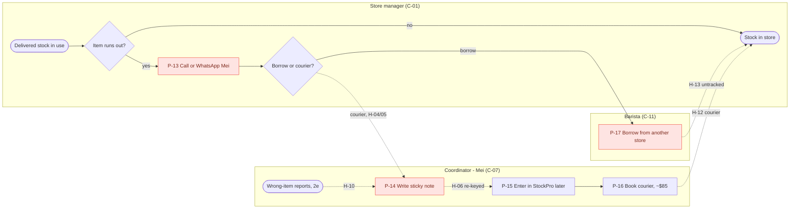
**What to notice:** this loop is what happens when the weekly process fails (≈ 4.3 couriers a week, ≈ $19k a year). Both exception loops (2e and 2f) end up in the same sticky-note queue on Mei's desk. Borrowing is never recorded, and there is no written rule for choosing between borrowing and a courier.

**How to read it:**
- The main path runs left to right with **five lane changes**. Four of them are manual.
- Two loops lead out of the main path, and both feed back into Mei. Wrong items (P-12) and mid-week stockouts (P-13) end up as phone calls and sticky notes on the same desk that does the Monday re-keying.
- Three of the four decision points have no written rule: substitutions, delivery checks, and borrow-vs-courier. The fourth, the 10am deadline, exists but has no consequence.

> **Documented vs actual** (what people say should happen vs what does):
> - The Excel file has a **par-level column**, but managers ignore it because it hasn't been updated since 2024. Quantities are guessed (inputs/02).
> - The **10am Monday deadline** is missed about 2.4 times a week. The workaround is "I text Mei and hope" (inputs/02, 05).
> - Deliveries are **supposed to be checked**, but this happens only "if they're not slammed" (inputs/02).
> - **No written procedure** was mentioned for any step. New managers "learn from whoever trains them" (inputs/02). Whether a procedure exists is `TBD`.

---

## 3. Step analysis table

Times are per store order unless stated. "Wait before" is how long work sits before the step starts. Value: VA = value-adding, BVA = business value-adding (needed by the business, not the customer), NVA = non-value-adding.

| Step | Description | Who | System | Touch time | Wait before | Value | Waste (DOWNTIME) | Issue | Source |
|---|---|---|---|---|---|---|---|---|---|
| P-01 | Count all stock in store and back room on paper | Store manager | C-02 | 1–1.5 h | — (trigger: Sunday close) | BVA | Motion, Extra processing | Counts everything weekly, even slow movers [Assumption]. Done after close, in the manager's own time. | inputs/02 |
| P-02 | Type counts into the store's Excel file | Store manager | C-03 | P-02 to P-04 together: **1–2.5 h** (calculated: 2.5–3.5 h total − 1–1.5 h count; includes "chasing") | Overnight (Sun close → Mon morning); exact hours TBD | NVA | Transportation, Defects | Same data written twice. Typing error rate unknown. | inputs/02, 05 |
| P-03 | Decide order quantities "by guess" | Store manager | C-03, C-21 | (in P-02 figure) | 0 (same sitting) [Assumption] | VA | Defects, Overproduction, Inventory, Non-utilised talent | Par levels stale since 2024. No sales data (H-23 missing). No view of warehouse stock (H-24 missing), so managers over-order "just in case". | inputs/02, 03 |
| P-04 | Email order file to orders@ by 10am Monday | Store manager | C-03 → C-04 | (in P-02 figure) | 0 | NVA | Transportation, Waiting | 12 different file layouts. No receipt confirmation. | inputs/02, 03 |
| P-05 | *Exception:* text Mei that order is late | Store manager | C-05 | TBD | — | NVA | Waiting | 2.4 a week (≈ 20% of orders, calculated: 2.4 ÷ 12). Nothing happens when the deadline is missed. | inputs/02, 05 |
| P-06 | Open each file, read its layout, re-key ~40 lines into StockPro | Mei | C-04 → C-08 | 30–40 min per store (calculated: 6–8 h ÷ 12); **6–8 h a week in total** | 0–8 h on Monday (orders arrive 7–11am and are worked through in turn) [calculated] | NVA | Transportation, Defects, Extra processing, Inventory, Non-utilised talent | **Bottleneck.** One person. 31 errors in 12 weeks. Ordering failed when Mei was off in August. ≈ $10.6k–$14.1k a year (calculated at $34/h). | inputs/03, 04, 05 |
| P-07 | Generate and print pick lists | StockPro / Mei | C-08 | TBD | Overnight Mon → Tue | BVA | Waiting | Only as accurate as P-06. | inputs/03 |
| P-08 | Pick and pack store order | Pickers (2) | C-09 | TBD | Same day (Tue), TBD | VA | — | No issues reported except P-09. | inputs/03 |
| P-09 | *Exception:* supplier short-shipped, so substitute "the closest thing" without telling the store | Pickers | C-09 | TBD | — | NVA | Defects | No rule and no notice (H-11 missing). 11 in 12 weeks (≈ 0.9 a week, or ~8% of orders). Example: 16oz cups replaced by 12oz. | inputs/02, 03, 05 |
| P-10 | Deliver on 2 van routes | Driver | C-10 | TBD | 1–2 days (packed Tue → delivered Wed/Thu) | VA | Waiting (by schedule) | Works. Store gets no advance notice of what is coming (H-09). Capacity at 17 stores TBD. | inputs/02, 03 |
| P-11 | Receive delivery; check against order "if not slammed" | Shift lead | C-11 | TBD | On arrival | BVA | Defects | Often not checked, so errors are found later or never. No sign-off, so no accountability. | inputs/02, 04 |
| P-12 | *Exception:* report wrong items to Mei by email or WhatsApp | Shift lead / manager | C-05 → C-07 | TBD | TBD | NVA | Defects, Motion | ~10 a month. Not logged, and the fix is not described (credit? re-send?). | inputs/03 |
| P-13 | *Exception:* item runs out mid-week; phone or WhatsApp Mei | Store manager | C-05 | TBD | TBD (time from stockout to call) | NVA | Defects (failure demand), Waiting | This chat is the only stockout record: 54 in 12 weeks, likely under-reported. | inputs/02, 05 |
| P-14 | Write the request on a sticky note or notepad | Mei | C-06 | TBD | 0 | NVA | Transportation, Inventory | Paper queue. Invisible to anyone else. | inputs/03 |
| P-15 | Enter emergency order into StockPro "when I get a minute" | Mei | C-08 | TBD | TBD ("when I get a minute") | NVA | Waiting, Transportation | StockPro stock is wrong until it is entered [Assumption]. | inputs/03 |
| P-16 | Book courier | Mei | C-23 | TBD | TBD | NVA | Transportation | 52 in 12 weeks (≈ 4.3 a week) at ~$85, ≈ $19k a year. | inputs/03, 04, 05 |
| P-17 | Send a barista to borrow stock from another store | Barista | C-11 | TBD | TBD | NVA | Motion, Transportation, Non-utilised talent | "Most weeks in summer". Untracked (H-13). Takes a barista off the floor ($29/h). | inputs/02, 04 |

**Summary:** 17 steps: 3 VA, 3 BVA, 11 NVA. Seven of them (P-05, P-09, P-12 to P-17) exist only because something earlier went wrong.

---

## 4. Pain points and bottlenecks

**Bottleneck: P-06 — re-keying all store orders.** All 12 orders queue in front of one person on Monday. It is the step with the most touch time on the warehouse side (6–8 h). It has no backup: when Mei was away, "two stores got nothing for a week". At 17 stores it grows to about **8.5–11.3 h a week** (calculated: 6–8 h × 17 ÷ 12) for the same one person. Because deliveries run on a fixed Wed/Thu schedule, this bottleneck shows up as **capacity, error and continuity risk** rather than as a longer cycle time. That is why "it works most weeks" hides it.

| # | Pain point | Steps | Finding (lens) | Impact | Links | Root cause known? |
|---|---|---|---|---|---|---|
| 1 | Orders re-typed by one person from 12 different file layouts | P-04, P-06 | Transportation, Defects, Extra processing (Lean). NVA (value). Unstructured handoff (H-02, H-03). | 6–8 h a week ≈ $10.6k–$14.1k a year. 31 errors in 12 weeks (≈ 22% of weekly orders, or 0.5% of lines, if one error per order; calculated). Single point of failure. Does not scale to 17 stores. | context.md › Pain points #2, #3, #9 · H-03 (🔴) | **Yes:** no standard file, and StockPro's import is not set up. |
| 2 | Quantities guessed, with no sales or warehouse data | P-03 | Defects, Overproduction, Inventory, Non-utilised talent (sales data unused). Decision with no current rule (handoffs). | Drives stockouts (4.5 a week; oat milk 21 and 16oz cups 14 in 12 weeks) and "just in case" stock in back rooms while the warehouse runs short [Assumption: causal link to test]. | Pain points #1, #8, #12 · H-14, H-23, H-24 (🔴) | **Partly.** Why par levels have no owner and no review → `/ba-gap` |
| 3 | Emergency path: untracked failure demand | P-13 to P-17 | Defects, Motion, Transportation, Inventory (paper queue). All NVA. Untracked handoffs H-04 to H-06, H-13. | ~4.3 couriers a week ≈ $19k a year, plus barista time, plus Mei's interruptions. It is also the **only** stockout record, so the business-case baseline is weak. | Pain points #1, #6 · H-04, H-05, H-06, H-12, H-13 | **No.** It is a symptom of #2, #4 and #5 → `/ba-gap` |
| 4 | Unannounced substitutions | P-09 | Defects. Handoff missing (H-11). No rule for the decision. | 11 in 12 weeks. The store receives items it can't use and then runs out (e.g. 16oz cups, the #2 stockout item). | Pain point #7 · H-11 (🔴) | **Partly.** There is no rule. Why suppliers short-ship is TBD → `/ba-gap` |
| 5 | Deliveries not checked; problems not logged | P-11, P-12 | Defects. Control applied inconsistently with no audit trail (handoffs). | Errors are caught late or never. ~10 complaints a month with no follow-up. "Nobody is accountable" for missing stock. | Pain point #11 · H-09, H-10 | **No.** Who owns stock at the store is undecided → `/ba-gap` |
| 6 | Managers count everything on paper and type it again | P-01, P-02 | Motion, Transportation, Extra processing. P-02 is NVA. | ~30–42 h a week across 12 stores ≈ $59k–$83k a year (calculated at $38/h, includes P-03 and P-04). Time off the floor (Goal 4). | Pain point #5 · H-01 | **Yes:** no stock data in the stores, and paper is the habit. |
| 7 | Late orders with no consequence | P-04, P-05 | Waiting. Rule exists but is not applied (handoffs). | 2.4 a week (≈ 20% of orders). Pushes Mei's Monday later. | Pain point #10 · H-02 | **No.** Why managers are late (time? Sunday close?) → `/ba-gap` |

---

## 5. Process metrics

**How the numbers were worked out:**
- **Cycle time** is Sunday-close count → Wed/Thu delivery ≈ 3–4 days (context.md, [Assumption]).
- **Touch time per store order (known parts)** = P-01 (1–1.5 h) + P-02 to P-04 (1–2.5 h) + P-06 (0.5–0.67 h) ≈ **3–4.2 h**. Times for P-07, P-08, P-10 and P-11 are TBD.
- **Process efficiency** (VA touch time ÷ cycle time) is **TBD**, because the VA steps P-03, P-08 and P-10 are not timed separately. Even a generous few hours of VA work in a 72–96 h cycle would be under 5% [Assumption]. That is typical for this kind of process.
- **Chain-wide effort** = managers 30–42 h × $38 × 52 ($59.3k–$83.0k) + Mei 6–8 h × $34 × 52 ($10.6k–$14.1k) ≈ **$70k–$97k a year**.

| Metric | As-is | To-be (estimate) | Change |
|---|---|---|---|
| Cycle time (main path, count → delivered) | 3–4 days [Assumption] | 3–4 days | None by design. Set by the fixed delivery schedule. Option to deliver a day earlier once Monday re-keying is gone (Q-14). |
| Touch time per store order (known parts) | ≈ 3–4.2 h | TBD. Re-keying share drops to the time needed to review flagged lines (target < 5 min per store [Assumption, to test in pilot]). Manager share: target to be set (context.md › success metrics: TBD). | ↓ |
| Chain-wide ordering effort | 36–50 h a week ≈ $70k–$97k a year | TBD. Mei's re-keying of 6–8 h a week is largely removed (CH-02). Manager time falls with CH-03 and CH-04 (amount TBD). | ↓ |
| Process efficiency (VA ÷ cycle) | TBD (likely < 5% [Assumption]) | TBD | — |
| Steps / NVA steps | 17 / 11 | 16 / 5 | −1 step, −6 NVA |
| Information handoffs / re-keyed or unstructured (paper, chat, free-form file) | 12 / 8 (H-01 to H-06, H-10, H-13) | 12 / 1 (log → StockPro for emergencies only) | −7 unstructured |
| Missing flows that people need | 4 (H-11, H-14, H-23, H-24) | 0 | −4 |
| Decision points with a written rule | 0 of 4 (late order, substitution, delivery check, borrow vs courier) | 4 of 4 | +4 |
| Order errors reported | 2.6 a week (≈ 22% of orders) | Re-keying errors removed. Remaining rate TBD until errors are split by cause (Q-05). | ↓ |
| Unannounced substitutions | 0.9 a week | 0 (all announced on the dispatch list) | −100% |
| Emergency (courier) orders | 4.3 a week ≈ $19k a year | Should fall with stockouts. Target ≈ 2.2 a week [Assumption: tracks the goal of halving stockouts] | ↓ ~50% (target) |
| Core-item stockouts | 4.5 a week (under-reported) | ≤ 2.25 a week (sponsor goal) | ↓ ≥ 50% |
| Volume per week | 12 orders, ~480 lines | 17 orders, ~680 lines by July 2027 | +42% |
| Coordinator re-keying time at 17 stores | 8.5–11.3 h a week (calculated) | TBD, roughly flat: import time does not grow with line count [Assumption] | Scales without a second coordinator (Goal 3) |

> The new log (CH-10) will at first make **reported** stockouts and errors go *up*, because they are no longer under-reported. Agree this with Priya and Tom up front so it isn't read as the process getting worse.

---

## 6. To-be process map

**Design constraints respected** (context.md › Constraints):
- Fits the ~$60k one-off budget.
- Nothing during the 1 Dec – 31 Jan freeze except low-risk logging and rules (see the phasing under §7).
- Delivered Feb–Jun 2027, before the new stores open in July.
- LedgerOne is untouched.
- Small IT team: changes reuse the existing StockPro import and TillPoint export rather than adding a new system.
- StockPro reaches end of support in Dec 2027, so the investment in it is kept minimal. The standard template and order format carry over to any future warehouse system.
- Adoption risk ("another system nobody uses properly"): the changes simplify tools managers already use (a spreadsheet template and a shared log).

The diagrams follow the same layout as section 2, so the two can be compared side by side. **6a** shows the phases. **6b–6g** show each phase that has a new or changed step. *Deliver* (T-11) is unchanged and appears only as the entry point of 6e. Phase 2 is renamed from "Re-key orders" to "Import orders", and phase 7 (monthly review) is new.

Legend (all diagrams): green = new or changed step · white = unchanged · dashed = manual handoff (physical goods or one remaining manual entry) · solid = structured or system handoff · rounded = start, end, or link to another diagram.

### 6a. Overview

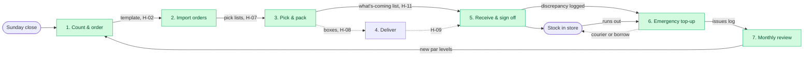

| Phase | Who | Steps | New or changed | Detail |
|---|---|---|---|---|
| 1. Count & order | Store manager, ordering template | T-01 to T-05 | all | 6b |
| 2. Import orders | Mei (or named backup), StockPro | T-06, T-07 | T-06 | 6c |
| 3. Pick & pack | Pickers, Mei | T-08, T-09, T-10 | T-09, T-10 | 6d |
| 4. Deliver | Driver | T-11 | — | entry point of 6e |
| 5. Receive & sign off | Shift lead | T-12, T-13 | both | 6e |
| 6. Emergency top-up | Store manager, Mei | T-14, T-15 | both | 6f |
| 7. Monthly review | Stock-rules owner (TBD) | T-16 | new phase | 6g |

### 6b. Count & order

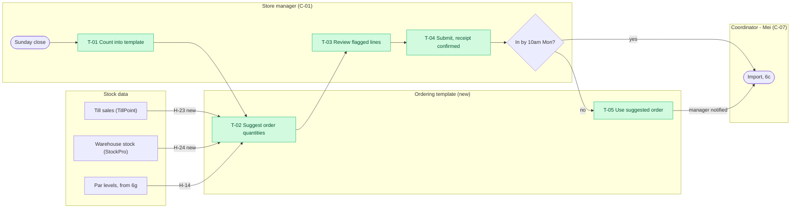
**What changes:** stock is counted once and typed once. The manager starts from a suggested order built from sales, warehouse stock and current par levels, and only fixes the flagged lines. A late order no longer depends on a text message (D-01).

### 6c. Import orders

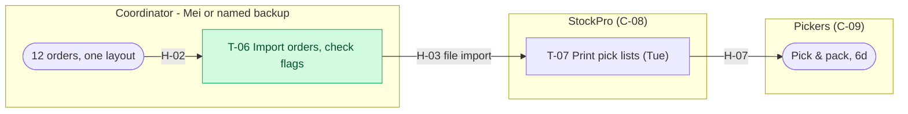
**What changes:** re-keying is eliminated (CH-02). A written routine and a named backup (CH-14), plus individual logins (CH-13), remove the "Mei at work?" single point of failure shown in 2c.

### 6d. Pick & pack

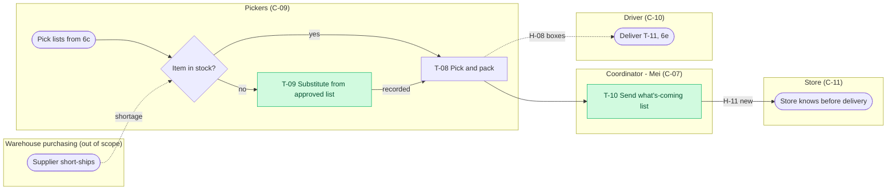
**What changes:** substitutes come from an approved list (D-02) and every substitution is recorded. Before the van arrives, the store gets a list of what's coming, including substitutions and shortages. Who sends it (Mei or a picker) is TBD.

### 6e. Receive & sign off

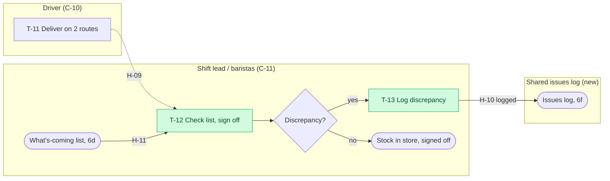
**What changes:** the "skip the check on a busy shift" branch from 2e is gone. The check is lighter, covering only flagged and core lines (D-04), but it always happens and is signed off.

### 6f. Emergency top-up

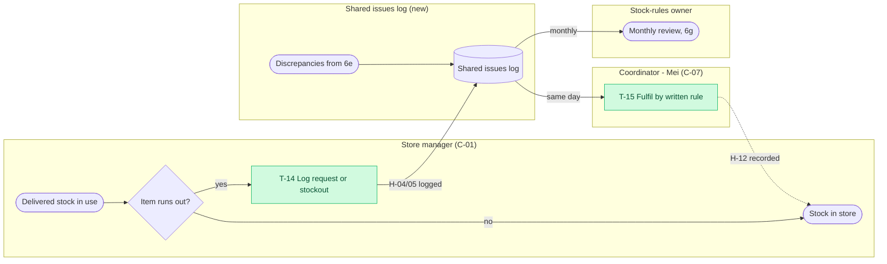
**What changes:** one shared log replaces the calls, chats and sticky notes. In T-15, Mei uses a written rule to choose between borrowing and a courier (CH-11) and enters the order in StockPro the same day. Borrowings are recorded.

### 6g. Monthly review (new)

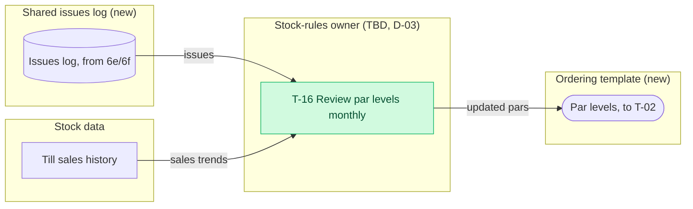
**What changes:** a named owner closes the gap that let par levels go stale after 2024. The issues log and sales history feed a monthly review, and the updated par levels feed the next week's suggested orders (T-02 in 6b).

**What changes, in business terms:**
- Managers count once, straight into one standard template, and start from a suggested order instead of a blank guess.
- The warehouse **imports** orders instead of re-typing them.
- Stores are **told what's coming**, including any substitutions, before the van arrives, and they sign off what they receive.
- Every emergency, stockout, borrowing and discrepancy goes into **one shared log**. A named owner uses it each month to keep the par levels current.

**Assumptions the design depends on** (validate before committing):
- StockPro's CSV import can accept store order lines (Q-10).
- StockPro can export available warehouse stock (Q-10).
- TillPoint product sales can be converted into warehouse-item usage, e.g. litres of oat milk per drink (Q-11).
- Store managers have a laptop or tablet they can use to count on the floor (Q-15).
- Until suggested orders exist (Phase 2), T-02 shows par levels only, and T-05 defaults to last week's order (D-01).

| To-be step | Replaces | Note |
|---|---|---|
| T-01 Count stock straight into template | P-01, P-02 | Combine. No paper. Later: weekly count of core and fast-moving items only (CH-03, phase 2). |
| T-02 Suggest quantities | new (adds H-23, H-24) | Uses sales since last order, current par levels, and warehouse availability. |
| T-03 Review suggestion and fix flagged lines | P-03 | Template flags lines far above par or with invalid codes (validation at entry). |
| T-04 Submit order, receipt confirmed | P-04 | One layout. Automatic confirmation. |
| T-05 Use suggested order and notify manager | P-05 | New rule for late orders (D-01). |
| T-06 Import all orders, review flagged lines | P-06 | Eliminates re-keying. |
| T-07 Print pick lists | P-07 | Unchanged. |
| T-08 Pick and pack | P-08 | Unchanged. |
| T-09 Substitute from approved list and record it | P-09 | New written rule (D-02). |
| T-10 Send what's-coming list to store | new (H-11) | Built from the packed pick list. Includes substitutions and shortages. |
| T-11 Deliver | P-10 | Unchanged. Capacity for 17 stores TBD (Q-17). |
| T-12 Check delivery against list and sign off | P-11 | Simplified: check against the list, focusing on flagged and core lines (D-04). |
| T-13 Log discrepancy | P-12 | Shared log replaces chat. |
| T-14 Log emergency request or stockout | P-13, P-14 | Shared log replaces chat and sticky notes. |
| T-15 Fulfil by rule: borrow or courier, enter same day | P-15, P-16, P-17 | Combine. Borrowings are recorded. |
| T-16 Monthly review of par levels and issue log | new | Named owner (D-03). Closes the loop on stale par levels. |

---

## 7. Change list and recommendations

| ID | Change | Fixes | Creates | Method | Impact | Effort | Needs | |
|---|---|---|---|---|---|---|---|---|
| CH-01 | **One standard order template for all 12 stores:** fixed product codes, one layout, basic checks (valid item, quantity well above par flagged) | P-02, P-03, P-04 · H-02 | T-01, T-03, T-04 | Simplify | **High:** prerequisite for CH-02. Removes the "read carefully" work and catches errors at entry. | **Low:** a spreadsheet build, product list taken from StockPro | Template design, 1 h of training per manager [Assumption], item code list | ⚡ |
| CH-02 | **Import orders into StockPro** using its existing, unused CSV import. Stop re-keying. | P-06 · H-03 | T-06 | Eliminate | **High:** frees 6–8 h a week, removes re-keying errors, scales to 17 stores, reduces dependence on Mei | **Low–Medium:** depends on the import format (Q-10). IT/vendor set-up and testing. | System configuration (Josh or vendor), test with 2 stores | ⚡ if Q-10 confirms the import works |
| CH-03 | **Count straight into the template** (no paper). Phase 2: weekly count of core and fast-moving items only, with a full count less often. | P-01, P-02 · H-01 | T-01 | Combine, then Eliminate | **Medium:** part of the ~$59k–$83k a year of manager time | **Low** (phase 1), **Medium** (phase 2, needs CH-04 trusted first) | A device on the floor (Q-15), agreed core-item list, check of food-safety/expiry rules (Q-09) | |
| CH-04 | **Suggested order quantities and reset par levels** from TillPoint sales history | P-03 · H-14, H-23 | T-02 | Simplify (data at the point of decision) | **High:** targets the guesswork behind stockouts and over-ordering [Assumption: confirm in `/ba-gap`] | **Medium:** matching till products to warehouse items, a daily data feed | Data mapping (Q-11), TillPoint owner (Q-11), Josh's time | |
| CH-05 | **Show warehouse available stock in the template** when managers order | P-03 · H-24 | T-02 | Rearrange (information earlier) | **Medium:** reduces "just in case" orders | **Medium:** needs a regular StockPro export (Q-10) | System export, refresh routine | |
| CH-06 | **Receipt confirmation + late-order rule:** if no order by 10am Monday, the suggested order is used and the manager is told | P-04, P-05 · H-02 | T-04, T-05 | Rearrange / control | **Medium:** removes "text Mei and hope" and keeps Monday on schedule | **Low** | Policy decision D-01 (Priya) | ⚡ |
| CH-07 | **Written substitution rule:** a list of approved substitutes per item, with who approves anything else | P-09 · H-11 | T-09 | Control (rule at the earliest point) | **High:** stops the wrong-item cause of stockouts (e.g. 16oz cups) | **Low** | Policy D-02 (Mei + Priya), picker briefing | ⚡ |
| CH-08 | **"What's coming" list sent to each store before delivery**, including substitutions and shortages | P-09, P-11 · H-09, H-11 | T-10 | Control (new handoff) | **Medium–High:** stores can react before they run out. Daniel asked for this. | **Low:** built from the packed pick list | Who sends it and when (Mei or pickers) | ⚡ |
| CH-09 | **Check delivery against the list and sign it off**, focusing on flagged and core lines so it is doable on a busy shift | P-11 | T-12 | Simplify | **Medium:** errors caught on day 1. Creates accountability. | **Low** | Decision D-04 on stock accountability at the store (context.md Open question #14), shift-lead training | ⚡ |
| CH-10 | **One shared issues log** for emergency requests, stockouts, borrowings, discrepancies and substitutions (store, item, quantity, date, reason) | P-12, P-13, P-14, P-17 · H-04, H-05, H-10, H-13 | T-13, T-14 | Eliminate (sticky notes) + Combine | **High:** gives the first reliable stockout and error baseline for the business case. Removes the paper queue. | **Low:** a shared form or sheet | Log owner (D-03), manager habit, Priya's OK to start before the freeze | ⚡ |
| CH-11 | **Emergency rule:** when to borrow from a nearby store vs book a courier; enter in StockPro the same day | P-15, P-16, P-17 · H-06, H-12, H-13 | T-15 | Simplify / control | **Medium:** part of ~$19k a year in couriers, plus barista time | **Low** | Rule agreed by Priya + Mei | ⚡ |
| CH-12 | **Named stock-rules owner + monthly review** of par levels against sales and the issues log | P-03 · H-14 (C-21) | T-16 | Control (new owner) | **High:** stops par levels going stale again. Spreads Mei's knowledge [Assumption: likely root cause, test in `/ba-gap`]. | **Low–Medium:** about 1–2 h a month [Assumption] | Role decision D-03 (Priya) | |
| CH-13 | **Individual StockPro logins** for everyone who imports or enters orders | P-06, P-15 (accountability) | T-06, T-15 | Control | **Medium:** audit trail of who changed which order | **Low** | Josh or vendor; licence cost TBD | ⚡ |
| CH-14 | **Write down and cross-train** the import, emergency and substitution routines, with a named backup for Mei | P-06, P-14, P-15 | T-06, T-15 | Control (continuity) | **High** for continuity: prevents a repeat of August | **Low** | 1–2 sessions with Mei and the backup | ⚡ |

**Decisions needed** (owner in brackets):
- **D-01** Late-order default: suggested order, or last week's order until CH-04 is live (Priya).
- **D-02** Substitution rule and who approves exceptions (Mei + Priya).
- **D-03** Who owns stock rules and the issues log (Priya).
- **D-04** Who is accountable for stock once it is signed for at the store (Priya + Tom).

**Suggested sequence** (respects the freeze and the Feb–Jun window):
- **Phase 0, now to 30 Nov 2026** (low-risk, policy and logging only; confirm with Priya): CH-10 issues log, CH-07 substitution rule, CH-13 logins, CH-14 write-down. The log starts building the baseline the business case needs.
- **Phase 1, Feb–Mar 2027:** CH-01 template and CH-02 import (pilot with 2 stores, then all 12), CH-06, CH-08, CH-09, CH-11, CH-03 phase 1.
- **Phase 2, Mar–Jun 2027:** CH-04 suggested orders and par reset, CH-05 warehouse stock view, CH-12 monthly review, CH-03 phase 2. The 5 new stores start on the new process in July.

**Business-first note:** none of these changes needs a new system. CH-02, CH-05 and CH-13 use the existing warehouse system's own functions. Given its Dec 2027 end of support, no deeper investment in it is recommended until the upgrade path is known (system map Q-05).

---

## Open questions
All are *not asked — --no-questions*.

| ID | Question | Why it matters | Ask |
|---|---|---|---|
| Q-01 | Is the step order right? Is anything missing, e.g. putting stock away, how Mei fixes a wrong-item complaint (re-send? credit?), or what happens when an item is short and there is no substitute? | Walk-through (step 2) | Mei, Daniel |
| Q-02 | Touch times for P-02/P-03/P-04 separately, P-07, P-08 (pick time per store), P-10 (route time), P-11 (check time) | Process efficiency and to-be estimates are TBD without them | Mei, a picker, driver, shift lead |
| Q-03 | Wait times: how long after re-keying is finished are pick lists printed? When are late orders keyed? | Cycle-time detail | Mei |
| Q-04 | Emergency path: time from stockout to courier arrival; how long notes wait before StockPro entry; how often borrowing is used vs courier | Sizing CH-10 and CH-11 | Mei, store managers |
| Q-05 | Of the 31 order errors, how many come from re-keying vs picking vs the store's own order? *(Lean: what gets corrected most often?)* | Sizes the benefit of CH-02 | Mei, sample of complaint emails |
| Q-06 | Where does work wait the longest from Mei's point of view? *(Lean)* | Confirms the bottleneck | Mei |
| Q-07 | Who decides on substitutions today, and on what basis? How often do suppliers short-ship? *(Handoffs)* | Designing CH-07 | Mei, a picker |
| Q-08 | When an order arrives, how does Mei know it is complete? How often does she go back to a manager to clarify? *(Handoffs)* | Hidden rework in P-06 | Mei |
| Q-09 | Would anyone notice if slow-moving items were counted less often? Are there food-safety or expiry rules that need a count? *(Value)* | CH-03 phase 2 | Priya, store managers |
| Q-10 | What file format does StockPro's import accept, and can it import store orders? Can it export available stock daily? | CH-02 and CH-05 depend on it | Mei, Josh, StockPro vendor |
| Q-11 | Can TillPoint products be matched to warehouse items (e.g. oat milk per drink)? Who owns TillPoint? | CH-04 depends on it | Josh, Tom, Priya |
| Q-12 | Is defaulting a late store to its suggested (or last week's) order acceptable? | D-01, CH-06 | Priya |
| Q-13 | Who should own stock rules and the issues log? | D-03, CH-10, CH-12 | Priya |
| Q-14 | Once Monday re-keying is gone, could deliveries move a day earlier (Tue/Wed)? | The only lever on cycle time | Mei, driver |
| Q-15 | Reaction to the proposed changes (skill step 4), especially counting on a device on the floor: is the store laptop usable for that? | Adoption risk | Daniel, 1–2 other managers |
| Q-16 | Do other stores follow the same steps and timings as Docklands? | The map is built from one store | 1–2 more store managers |
| Q-17 | Can the pickers, van and 2 routes handle 17 stores? | Unchanged steps T-08 and T-11 must scale | Mei, driver |

## Next steps
1. **Validate the map** in a 30-minute walk-through with Mei and Daniel, and if possible a manager from a quieter store. Answer Q-01 to Q-08 and fill the TBD timings.
2. **Check feasibility** of the three assumptions the to-be depends on: Q-10 (import and export), Q-11 (till-to-item matching) and Q-15 (counting device).
3. **Ask Priya for decisions D-01 to D-04**, and approval to start Phase 0 (issues log, substitution rule, logins) before the 1 Dec freeze.
4. **Run `/ba-gap samples/coffee-chain`** to find the root causes behind pain points #2, #3, #5 and #7, especially stale stock rules (C-21) and stock accountability.
5. **Run `/ba-requirements samples/coffee-chain`** to specify what the template, import, dispatch list and issues log must do (CH-01 to CH-13).
6. Consider a separate **`/ba-process samples/coffee-chain pastry-ordering`** if pastries are confirmed in scope, since they are ~$96k of the waste.

## Technique notes
**Sections**
- **Process scope (SIPOC).** SIPOC is a one-page scoping tool from Six Sigma. Agreeing the start and end events first stops the map from sprawling. Here it also showed that nobody owns the process end to end.
- **As-is map.** Swimlane diagrams make handoffs visible. Every time the flow crosses a lane, ownership changes, and that's where delays and errors cluster. Note how both exception loops land on Mei's lane. For a long process, an overview of phases plus one detailed diagram per problem phase keeps each diagram readable without hiding the exceptions.
- **Step table.** Separating touch time from wait time is the key insight: improvement usually comes from cutting waiting, not from making people work faster. Here most of the waiting is set by the delivery schedule, so the gains are in effort and errors instead.
- **Pain points and bottlenecks.** Theory of Constraints: a process can only go as fast as its bottleneck, and improving any other step first adds little. A bottleneck can show up as risk and capacity limits (P-06) rather than as visible delay.
- **Metrics.** Baseline numbers turn "it feels slow" into a business case. Even rough estimates are better than none, as long as they are labelled.
- **To-be map.** Keep the to-be at the same level of detail as the as-is. A vague to-be hides the hard decisions (D-01 to D-04 here).
- **Change list.** An impact/effort view lets stakeholders pick a sequence: quick wins first to build trust, then the bigger structural changes.

**Lenses**
- **Lean waste (DOWNTIME).** A memory aid for the 8 wastes of Lean. In office processes, Waiting and Defects usually dominate. Here Transportation (re-keying) and Defects dominate.
- **Value-added analysis.** Most office processes are under 10–20% value-adding time. BVA steps can't be removed, but they can be simplified. The delivery check (P-11 → T-12) is kept but made lighter.
- **ECRS.** The order matters: the cheapest improvement is removing a step entirely. Re-keying is *eliminated* (CH-02) before anything is automated, and the template is *simplified* (CH-01) first so the import doesn't just "make waste faster".
- **Handoffs and controls.** Every handoff is a chance for delay, error and lost accountability. Counting unstructured handoffs (8 → 1) and decisions with written rules (0 → 4) is a simple, persuasive before/after metric.
