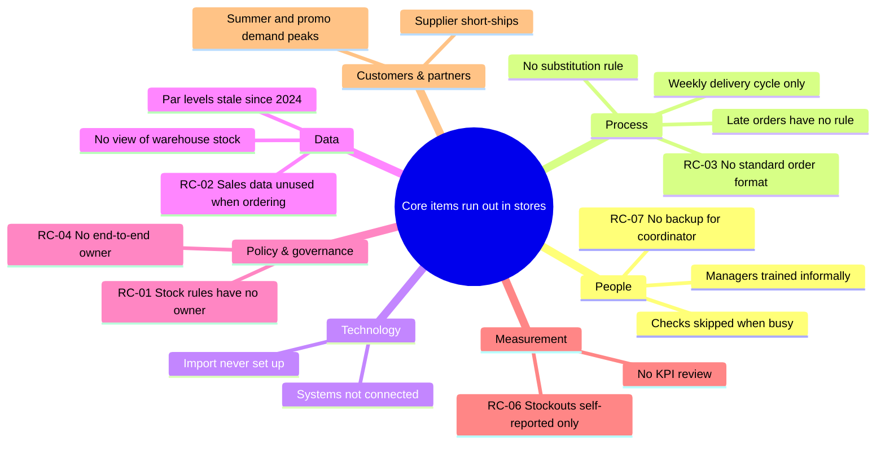
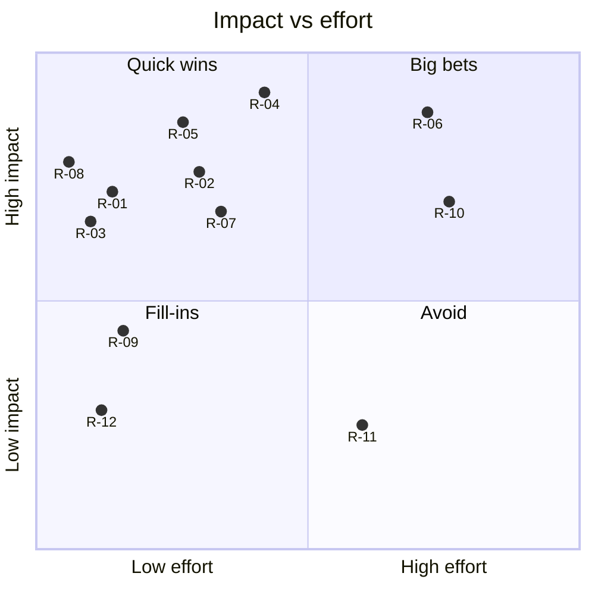

# Gap analysis, root causes and recommendations: Stock ordering

- **Engagement:** Harbour Lane Coffee Co. — Stock ordering review (`samples/coffee-chain`)
- **Date:** 2026-11-12
- **Mode:** `--no-questions`. Built only from `context.md`, `inputs/` and existing outputs. The target state and the priority problems (skill step 2) were **not** confirmed with the user. Missing facts are `TBD`. Every question I would have asked is under **Open questions**.
- **Sources used:** `context.md`, `inputs/01-kickoff-meeting-notes.md`, `inputs/02-interview-store-manager.md`, `inputs/03-interview-warehouse-coordinator.md`, `inputs/04-interview-finance.md`, `inputs/05-ops-data-summary.md`, `outputs/01-system-map.md` (`C-`/`H-` IDs), `outputs/02-process-store-replenishment.md` (`P-`/`T-`/`CH-`/`D-` IDs).
- **Dimensions used:** People · Process · Technology · Data · Policy & governance · Measurement · Customers & partners.
- **Open questions:** 16. See the end of the document. The most important: confirm the target state (Q-01), whether pastries are in scope (Q-03), and what the StockPro import can do (Q-07).

**In one paragraph.** Stockouts, waste and the dependence on one coordinator look like three separate problems. They share a small set of causes. Nobody owns the stock rules, so par levels (target stock per store) have been stale since 2024. The person choosing order quantities never sees the sales or warehouse data that already exists. The chain grew from 4 to 12 stores without a standard way to order, so orders are re-typed by hand. Nothing is measured well enough to show any of this. Most fixes are rules, owners and a standard template, not new systems. They fit the ~$60k budget and the Feb–Jun 2027 window. The one large decision, what replaces or upgrades StockPro before its Dec 2027 end of support, should be prepared now and made after the new stores open.

### Target state used (not confirmed: `--no-questions`)
From context.md › Goals and success criteria. To be in place **before the 5 new stores open (July 2027)**.

| # | Target | Baseline → target | Source |
|---|---|---|---|
| TS-1 | Fewer stockouts of core items | 4.5/wk reported (under-reported) → ≤ 2.25/wk | inputs/01, 05 |
| TS-2 | Less recorded stock waste | ≈ $182k/yr → 10–20% lower ($146k–$164k) | inputs/01, 04 |
| TS-3 | Ordering scales to 17+ stores with one coordinator, and survives that person being away | 1 coordinator, ordering failed in Aug 2026 → still 1, with a trained backup | inputs/01, 03 |
| TS-4 | Less manager time on ordering paperwork | 2.5–3.5 h/wk per store → TBD (target not set) | inputs/01, 05 |
| TS-5 *(implied)* | Clear accountability for stock and a measured, trusted baseline | "Nobody is accountable"; baselines disputed → named owners; one agreed set of numbers | inputs/04, 05 [Assumption: implied by Tom's concerns] |

### Priority problems root-caused (default: all five, largest impact first)
1. Core items run out in stores (TS-1).
2. Stock is wasted, mostly pastries and syrups (TS-2).
3. Ordering depends on one person and won't scale (TS-3).
4. Managers spend hours counting and typing (TS-4).
5. Wrong items reach stores unannounced and unchecked, and nobody is accountable (TS-1, TS-5).

---

## 1. Gap analysis (current vs target)

Size = impact on the target state. **H** = blocks a target directly. **M** = contributes. **L** = minor or indirect.

### People
| ID | Current state | Target state | Gap | Symptoms | Size | Links | Source |
|---|---|---|---|---|---|---|---|
| G-01 | One coordinator re-keys every order, sets reorder points "from experience" and holds the emergency queue on sticky notes. Nothing is written down and there is no backup. | Coordinator routines are documented and a trained backup can run a full week. | Single point of failure; knowledge held by one person | Aug 2026: "two stores got nothing for a week" | H | C-07, H-15, P-06, P-14 | inputs/01, 03 |
| G-02 | Managers spend 2.5–3.5 h/wk each counting and ordering, learn "from whoever trains them" and order "by guess". | Managers follow one short routine, start from a suggested order and spend less time off the floor. | No standard routine or training; manager time spent on low-value work | ~30–42 h/wk chain-wide ≈ $59k–$83k/yr; "3 hours easy, plus chasing" | M | C-01, P-01–P-04 | inputs/02, 05 |

### Process
| ID | Current state | Target state | Gap | Symptoms | Size | Links | Source |
|---|---|---|---|---|---|---|---|
| G-03 | 12 store-specific Excel layouts are emailed, then ~480 lines/wk are re-typed into StockPro. | Orders are captured once in one format and loaded without re-typing. | No single order format or entry point | 6–8 h/wk re-keying; 31 order errors in 12 wks; "100 lids instead of 10" | H | C-03, C-04, H-02, H-03, P-06 | inputs/02, 03, 05 |
| G-04 | Exceptions have no written rule: substitutions, late orders, borrow vs courier. | Each exception has a written rule and a named decider. | No rules for the four decision points | 11 unannounced substitutions in 12 wks; 2.4 late orders/wk; "text Mei and hope" | H | H-11, P-05, P-09, P-17 | inputs/02, 03, 05 |
| G-05 | Stores get no notice of what's coming, and deliveries are checked only "if not slammed". | Stores know what's coming and sign off deliveries against a list. | No advance notice; receipt check optional | Errors found late or never; ~10 wrong-item complaints/month | M | H-09, H-10, P-11, P-12 | inputs/02, 03 |
| G-06 | Emergency orders go by phone/WhatsApp → sticky note → StockPro "when I get a minute". | Emergency requests are logged once, visible to the team and entered the same day. | Informal, untracked emergency path | ~4.3 couriers/wk ≈ $19k/yr; StockPro levels wrong in the meantime [Assumption] | M | H-04–H-06, P-13–P-16 | inputs/03, 04, 05 |

### Technology
| ID | Current state | Target state | Gap | Symptoms | Size | Links | Source |
|---|---|---|---|---|---|---|---|
| G-07 | StockPro, TillPoint and LedgerOne are not connected. StockPro's CSV import exists but "nobody has set up". | Order files and sales data flow into ordering without re-typing. | Existing capability unused; no data links | Re-keying (G-03); sales data used for revenue only | H | C-08, C-13, H-03, H-23 | inputs/03, 04 |
| G-08 | StockPro is ~9 years old; the current version goes end-of-support Dec 2027. | A supported warehouse system that copes with 17+ stores beyond 2027. | No decided future for the warehouse system | Risk of stranded spend; upgrade path and cost TBD | H (risk) | C-08 | inputs/03 |
| G-09 | Supplier invoices are matched by hand against printed POs (~2 days/month). | Invoices matched against electronic POs. | Manual matching step | Accounts assistant time | L | H-18 | inputs/04 |

### Data
| ID | Current state | Target state | Gap | Symptoms | Size | Links | Source |
|---|---|---|---|---|---|---|---|
| G-10 | Managers decide quantities without sales history or warehouse availability. | Sales since the last order and warehouse stock are shown when ordering. | Decision data exists but doesn't reach the decision | Over-ordering "just in case" while the warehouse runs short; stockouts | H | H-23, H-24, P-03 | inputs/02, 03, 04 |
| G-11 | Par levels not updated since 2024 (stores tripled since); reorder points undocumented. | Par levels and reorder points based on recent demand, documented and current. | Stale, undocumented stock rules | Ordering "by guess"; oat milk 21 and 16oz cups 14 stockouts in 12 wks | H | C-21, H-14, H-15 | inputs/02, 03, 05 |
| G-12 | Stock on hand at stores isn't tracked. Borrowing between stores isn't recorded. | Store stock and transfers are visible. | No store-level stock record | Counts and waste figures distorted [Assumption]; stock "missing" with no trace | M | H-13, C-11 | inputs/02, 04 |

### Policy & governance
| ID | Current state | Target state | Gap | Symptoms | Size | Links | Source |
|---|---|---|---|---|---|---|---|
| G-13 | Nobody owns replenishment end to end, or stock once it reaches a store. | A named process owner, and clear accountability for stock at each stage. | Ownership and accountability undefined | "If stock goes missing, nobody is accountable"; complaints with no follow-up | H | P-11, H-10, D-04 | inputs/04; 02-process › SIPOC |
| G-14 | Par levels have no owner. The pastry standing order has no clear owner or review cycle. | Each stock rule has a named owner and a review cycle. | Rule ownership missing | Rules go stale (G-11, G-19) | H | C-20, C-21, D-03 | inputs/02, 03 |
| G-15 | Everyone in the warehouse uses one shared StockPro login. | Individual logins with an audit trail. | No access control or audit trail | Can't trace who changed an order | M | C-08 | inputs/03, 04 |

### Measurement
| ID | Current state | Target state | Gap | Symptoms | Size | Links | Source |
|---|---|---|---|---|---|---|---|
| G-16 | Stockouts are self-reported on WhatsApp ("they just tell me when they're angry"). Lost sales are not measured. | Stockouts are logged consistently and lost sales estimated. | No reliable stockout measure | Baseline likely under-reported; Tom wants evidence for "big" lost sales | H | H-04, C-05 | inputs/03, 04, 05 |
| G-17 | Waste logs are complete in ~8 of 12 stores. Two waste figures are in use ($182k vs ~$250k). | One complete, agreed waste figure by store and category. | Incomplete waste data; disputed baseline | Business case harder to prove | H | C-17, C-18, H-20 | inputs/01, 04 |
| G-18 | No targets for manager ordering time or order errors. No regular review of ordering KPIs. | A small KPI set with targets, reviewed monthly by an owner. | No feedback loop | Problems surface only as complaints | M | — | context.md › Goals (TBD) |

### Customers & partners
| ID | Current state | Target state | Gap | Symptoms | Size | Links | Source |
|---|---|---|---|---|---|---|---|
| G-19 | The Crumb & Co. standing order is changed "maybe twice a year" and not adjusted for quieter winter trade. | Pastry quantities follow demand by store and season. | Supplier order not linked to demand | "We bin maybe 15–20 pastries a day"; pastries ≈ $96k of $182k waste | H | C-20, H-26 | inputs/02, 04 |
| G-20 | Supplier short-shipments aren't recorded or raised with suppliers. | Short-ships recorded at goods receipt and reviewed with suppliers. | No supplier performance tracking | Short-ships lead to substitutions (G-04) | M | C-12, H-17 | inputs/03 |

**Gaps by dimension:** People 2 · Process 4 · Technology 3 · Data 3 · Policy & governance 3 · Measurement 3 · Customers & partners 2 = **20 gaps** (11 High, 8 Medium, 1 Low).

---

## 2. Root cause: 5 Whys

#### Problem 1: Core items run out in stores, and "customers walk out" (links: G-10, G-11, G-14, G-16; P-03; TS-1)
1. **Why do stores run out?** Between weekly deliveries they use more of some items than they ordered or received. Oat milk (21) and 16oz cups (14) account for 35 of the 54 reported stockouts. (inputs/05)
2. **Why don't orders match use?** Managers guess quantities. The par-level column hasn't been updated since 2024, and sales data isn't used. (inputs/02)
3. **Why are par levels stale?** Nobody is responsible for keeping them current and there is no review cycle. The chain went from 4 to 12 stores in that time. (inputs/01, 02; system map C-21)
4. **Why wasn't this noticed and fixed?** Stockouts are only self-reported in chat and no one reviews them as a KPI, so the drift was invisible. (inputs/03, 05)
   - *Branch, at Why 2:* **Why is the warehouse sometimes short as well?** Stores can't see warehouse stock, so they over-order "just in case". Stock then sits in back rooms while the warehouse runs out. Reorder points are set "from experience" rather than from demand. (inputs/02, 03)
   - *Branch, at Why 1:* Some stockouts come from receiving the wrong item. 16oz cups were replaced by 12oz without notice. See Problem 5. (inputs/02)

**Root cause RC-01** (Policy & governance): stock rules (par levels and reorder points) have no owner, no agreed method and no review cycle. · Confidence: **High** (direct quotes from two roles) · Verify with: Priya, Mei, a second store manager.
**Root cause RC-02** (Data): ordering is designed around a manual count. Demand (TillPoint sales) and warehouse availability never reach the person choosing quantities. · Confidence: **High** · Verify with: Josh (can the data be extracted?), Daniel.
**Contributing RC-06** (Measurement): see Problem 2.

#### Problem 2: Stock is wasted, about $182k/yr recorded (links: G-17, G-19, G-14; TS-2)
1. **Why is so much wasted?** Pastries (~$96k) are binned at the end of the day, syrups (~$31k) expire, and ~$55k is damaged or other. (inputs/04)
2. **Why are pastries over-supplied?** The standing order is fixed and changed "maybe twice a year". It wasn't cut for the quieter winter trade. (inputs/02)
3. **Why isn't it changed more often?** No one is clearly responsible for reviewing it, and nobody compares it with pastry sales. TillPoint has the sales data. (system map C-20; inputs/04)
4. **Why do syrups expire?** Managers over-order "just in case", and there is no view of store stock or expiry dates [Assumption: expiry handling not described; verify]. This ties back to RC-01 and RC-02.
5. **Why hasn't the waste been tackled already?** Waste data is incomplete (4 stores) and disputed ($182k vs $250k), and no one reviews it by store and item. (inputs/01, 04)

**Root cause RC-05** (Customers & partners): the pastry standing order with Crumb & Co. isn't owned or linked to sales, so it can't follow demand. · Confidence: **Medium** (one store's evidence; scope `TBD`) · Verify with: Priya, 2–3 managers, a TillPoint pastry-sales extract.
**Root cause RC-06** (Measurement): stockouts, order errors and waste aren't captured in a structured way or reviewed against targets. There is no feedback loop to correct the rules, and no evidence for the business case. · Confidence: **High** · Verify with: Tom.

#### Problem 3: Ordering depends on one person and won't scale to 17 stores (links: G-01, G-03, G-07; P-06; TS-3)
1. **Why does it depend on Mei?** She re-types every order (~480 lines/wk), runs the emergency queue and is the only person who knows the reorder points. (inputs/03)
2. **Why is she re-typing?** Orders arrive as 12 different Excel layouts, and StockPro's CSV import has never been set up. (inputs/03)
3. **Why 12 layouts and no import?** As the chain grew from 4 to 12 stores, each manager adapted their own file ("I added my own columns"). No standard order format was ever defined, and without one the import can't be used. (inputs/01, 02, 03)
4. **Why was no standard set?** Nobody owns the ordering process end to end. Store and warehouse each run their own part. (02-process › SIPOC; inputs/04) → see RC-04.
   - *Branch, at Why 1:* **Why is there no backup?** Her routines and reorder logic aren't written down, and nobody has been trained to cover. A casual picker tried in August and failed. (inputs/03)

**Root cause RC-03** (Process): no standard order format or ordering procedure was set as the chain grew, which blocks the existing import and forces re-keying. · Confidence: **High** · Verify with: Mei; samples of 2–3 store files (Q-08).
**Root cause RC-07** (People): coordinator knowledge and routines are undocumented and there is no trained backup. · Confidence: **High** · Verify with: Mei, Priya.

#### Problem 4: Managers spend 2.5–3.5 h a week counting and typing (links: G-02, G-12; P-01–P-04; TS-4)
1. **Why so long?** They count every item on paper on Sunday night, type the counts into Excel on Monday, then decide quantities. (inputs/02)
2. **Why count everything by hand?** The store has no other record of stock on hand, and sales data isn't used to estimate usage: "If the till knows what we sold, why am I counting everything by hand?" (inputs/02, 04)
3. **Why isn't sales data used?** No one has linked till products to stock items or put sales into the order file. TillPoint is used only for revenue reporting. (inputs/04) → **RC-02**.
4. **Why on paper and then typed?** There's no standard template that can be filled in on the floor, and paper is the habit. (inputs/02) → **RC-03**.

*No new root cause.* This problem is explained by RC-02 and RC-03. Confidence: **Medium** (time data from 2 managers, 1 interview on file).

#### Problem 5: Wrong items reach stores unannounced and unchecked, and nobody is accountable (links: G-04, G-05, G-13, G-20; P-09, P-11; TS-1, TS-5)
1. **Why do wrong items arrive?** Re-keying errors (31 errors in 12 wks, split by cause unknown) and unannounced substitutions (11 in 12 wks). (inputs/03, 05)
2. **Why are substitutions unannounced?** Pickers substitute "the closest thing". There is no rule about what may be swapped and no step to tell the store. (inputs/03)
3. **Why aren't errors caught on arrival?** Stores get no list of what's coming, and checking is optional ("if they're not slammed"). (inputs/02)
4. **Why are these handoffs left without rules?** No one owns the flow end to end, and accountability for stock at the store hasn't been decided. (inputs/04; 02-process D-04)

**Root cause RC-04** (Policy & governance): there is no end-to-end owner of replenishment, so exception handoffs (substitutions, delivery checks, late orders) have no rules and stock at the store has no accountable owner. · Confidence: **High** · Verify with: Priya, Tom.

### Root cause summary
| ID | Root cause | Dimension | Problems | Gaps | Confidence |
|---|---|---|---|---|---|
| RC-01 | Stock rules have no owner, method or review cycle | Policy & governance | 1, 2 | G-11, G-14 | High |
| RC-02 | Demand and warehouse data never reach the ordering decision | Data | 1, 2, 4 | G-10, G-12, G-07 | High |
| RC-03 | No standard order format or procedure, so the import is unused | Process | 3, 4 | G-03, G-02, G-07 | High |
| RC-04 | No end-to-end owner; exceptions have no rules; no stock accountability | Policy & governance | 3, 5 | G-04, G-05, G-13, G-06 | High |
| RC-05 | Pastry standing order not owned or linked to sales | Customers & partners | 2 | G-19, G-14 | Medium |
| RC-06 | Stockouts, errors and waste not measured or reviewed | Measurement | 1, 2 | G-16, G-17, G-18 | High |
| RC-07 | Coordinator knowledge undocumented; no backup | People | 3 | G-01 | High |

---

## 3. Fishbone: core-item stockouts

- **Confirmed root causes:** RC-01, RC-02, RC-04, RC-06 (directly behind stockouts). RC-03 and RC-07 act through errors and continuity failures (the August outage).
- **Contributing factors:** weekly delivery cycle (P-10), supplier short-ships (G-20), summer and promo demand peaks (inputs/01, 02), skipped delivery checks (P-11), informal manager training (inputs/02).
- **Not yet evidenced:** van and picker capacity at 17 stores (Q-12). Whether supplier short-ships are frequent enough to matter is TBD (Q-11).

---

## 4. SWOT

| | Helpful | Harmful |
|---|---|---|
| **Internal** | **Strengths** - TillPoint gives reliable daily sales by product (H-22). The demand data already exists. - StockPro has a CSV import that's already paid for (inputs/03). - Picking, pick lists and van routes work (C-10, H-07, H-08). - Engaged sponsor, Finance support and an approved ~$60k one-off budget (inputs/01, 04). - Staff with ideas and deep know-how: Daniel's "use the till" idea; Mei's knowledge (inputs/02, 03). | **Weaknesses** - Single point of failure in the coordinator role (G-01). - Stale, unowned stock rules (G-11, G-14). - Manual re-keying and 12 order layouts (G-03). - Weak, disputed baselines (G-16, G-17). - No end-to-end owner or stock accountability (G-13). - Thin IT capacity: one generalist plus a contractor (inputs/01). |
| **External** | **Opportunities** - 5 new stores can **start** on a standard process rather than be migrated later. - StockPro's end of support forces a warehouse-system decision. It's a chance to choose for 17+ stores. - Quieter winter trade: a natural moment to cut pastry standing orders (inputs/02). - Crumb & Co. may accept more flexible or seasonal orders [Assumption, to test]. | **Threats** - StockPro end of support, Dec 2027 (inputs/03). - Summer and promo demand peaks drive stockouts and couriers (inputs/01, 02). - Supplier short-ships (inputs/03). - Customers walk out on stockouts, and may go to competitors [Assumption]. - Board and investors need evidence; a weak baseline could stall the business case (inputs/01, 04). |

**Strategic implications**
- **SO:** Use the TillPoint sales data and the unused import to set up a standard, demand-based ordering routine **before** the new stores open, so stores 13–17 start on it from day one (R-04, R-05, R-06).
- **ST:** Make the standard order format independent of any system. It then carries over to whatever replaces or upgrades StockPro, which reduces the end-of-support risk (R-04, R-10).
- **WO:** Use the Dec–Jan change freeze to *build the baseline* (issues log, complete waste logs). Logging is low-risk, and the data strengthens the board case (R-01).
- **WT:** One coordinator, plus summer peaks, plus 42% more order lines is a repeat of August on a bigger scale. Documentation and a trained backup can't wait for the new systems (R-03).

---

## 5. Recommendations

Impact and effort are scored 1–5. Effort is relative: cost, time and disruption, with Josh's capacity in mind. Costs are `TBD` until scoped. `CH-` = matching change in `02-process-store-replenishment.md`.

| ID | Recommendation | Addresses | Impact | Effort | Category | KPI (baseline → target) | Risks / dependencies |
|---|---|---|---|---|---|---|---|
| R-01 | **Start measuring now.** One shared issues log for stockouts, emergency requests, borrowings, wrong items and substitutions. Plus a 4–6 week push for complete waste logs in all 12 stores. (CH-10) | RC-06 · G-16, G-17, G-06, G-12 | 4: creates the baseline the business case needs and replaces sticky notes | 1: a shared form; manager habit | ⚡ | Stores logging waste 8/12 → 12/12; stockout log in use at 12/12 stores | Reported stockouts will **rise** at first as under-reporting stops. Agree this with Priya and Tom up front. |
| R-02 | **Rules for exceptions.** A written substitution rule (approved swaps per item, plus who approves others), a "what's coming" list sent before each delivery, and a sign-off at receipt focused on core lines. (CH-07, CH-08, CH-09) | RC-04 · G-04, G-05 | 4: removes a known cause of stockouts (e.g. 16oz → 12oz cups) | 2: rules, a list built from the pick list, briefing | ⚡ | Unannounced substitutions 0.9/wk → 0; deliveries signed off → 100% | Needs D-02 and D-04. The check must be quick enough for a busy shift. |
| R-03 | **Remove the single point of failure.** Document the coordinator's routines and reorder points, train a named backup, and give each warehouse user their own StockPro login. (CH-13, CH-14) | RC-07 · G-01, G-15 | 4: prevents a repeat of August; the audit trail supports accountability | 1: 1–2 sessions with Mei; logins via Josh or the vendor | ⚡ | Backup runs a full ordering week in a test; shared logins 1 → 0 | Licence cost per login TBD. Mei's time while the backlog is high. |
| R-04 | **Capture orders once.** One standard order template for all stores (fixed item codes, basic checks), loaded through StockPro's existing import. Includes receipt confirmation and a late-order rule. (CH-01, CH-02, CH-06) | RC-03 · G-03, G-07, G-02 | 5: frees 6–8 h/wk, removes re-keying errors, scales to 17 stores | 2–3: template build; import set-up and a 2-store pilot | ⚡ (if the import works, Q-07) | Re-keying 6–8 h/wk → < 1 h [Assumption]; order errors 2.6/wk → TBD (Q-06); late orders 2.4/wk → 0 unhandled | Import format unknown (Q-07). Light spend only, given StockPro's end of support. |
| R-05 | **Give stock rules an owner.** Name a stock-rules owner, reset par levels and reorder points from the last 12+ weeks of sales and usage, and review them monthly against sales and the issues log. (CH-12) | RC-01 · G-11, G-14 | 5: tackles the main cause of both stockouts and "just in case" waste | 2: a role decision; a one-off reset; 1–2 h/month [Assumption] | ⚡ | Core-item stockouts 4.5/wk → ≤ 2.25/wk; par levels reviewed monthly | Needs D-03. A first reset may need Mei's input, so do R-03 first or in parallel. |
| R-06 | **Put data in front of the decision.** Suggested order quantities from TillPoint sales, plus warehouse available stock shown in the template. Then count only core and fast-moving items weekly. (CH-03, CH-04, CH-05) | RC-02 · G-10, G-12, G-02 | 5: cuts guesswork and over-ordering; less counting | 4: matching till products to stock items, a regular data feed, IT time | 🎯 | Manager ordering time 2.5–3.5 h/wk → target TBD (Q-02); stockouts as R-05 | Depends on R-04 and on the item mapping (Q-09). Josh's capacity in Feb–Jun. |
| R-07 | **Make pastry orders follow demand.** Review each store's Crumb & Co. standing order against pastry sales by weekday and season, monthly, with a named owner. Discuss flexible or seasonal quantities with the supplier. | RC-05 · G-19, G-14 | 4: pastries are ~53% of recorded waste (~$96k) | 2: a sales extract and a supplier conversation | ⚡ (if in scope) | Pastry waste ≈ $96k/yr → –15–20% [Assumption: in line with TS-2] | **Scope is TBD (Q-03).** Supplier terms unknown. Watch for pastry stockouts. |
| R-08 | **Name an end-to-end owner** for replenishment, and decide who is accountable for stock at each stage (warehouse, in transit, at the store). (D-03, D-04) | RC-04 · G-13 | 4: unlocks R-02, R-05 and R-09; meets Tom's accountability concern | 1: a leadership decision | ⚡ | Owner named; accountability written into the store routine | Reporting lines TBD (Q-13). Must not become blame of individuals. |
| R-09 | **Agree a small KPI set** (stockouts, waste, order errors, couriers, manager time) with targets, reviewed monthly by the R-08 owner. | RC-06 · G-18 | 3: keeps the improvements from drifting | 1: uses R-01 data | 🧩 | KPI pack reviewed monthly from Mar 2027 | Needs R-01 data first. |
| R-10 | **Decide the warehouse system's future.** Get the StockPro vendor's upgrade path and cost now. Define requirements for 17+ stores. Choose upgrade or replace before Dec 2027. | G-08, G-07 (part of RC-02) | 4: avoids an unsupported core system | 4: option appraisal now; implementation likely after FY end | 🎯 | Decision by ~Sep 2027 [Assumption]; supported system in place before Dec 2027 | ⚠ Replacement may **exceed the ~$60k one-off** and add subscription costs (payback must be < 18 months), so likely FY2027–28 funding. Must not overlap the new store openings. |
| R-11 | Electronic PO matching for invoices in LedgerOne | G-09 | 2: ~2 days/month saved | 3: an integration with an end-of-life system | ⛔ Park | — | Revisit after R-10. Building a link to StockPro now could be wasted. |
| R-12 | Record supplier short-ships at goods receipt and review them with suppliers quarterly | G-20 (RC-04) | 2: fewer forced substitutions | 1: a field in the issues log or receipt routine | 🧩 | Short-ships per supplier tracked → baseline TBD | Fold into R-01 and R-02. |

### Logic check
- **Every priority problem has an actionable root cause.** P1 → RC-01, RC-02 (RC-06 contributes). P2 → RC-05, RC-06 (RC-01, RC-02 for syrups). P3 → RC-03, RC-07. P4 → RC-02, RC-03. P5 → RC-04. Each is a rule, owner, format or data flow the business controls, not "human error".
- **Every root cause has a recommendation.** RC-01 → R-05 · RC-02 → R-06 · RC-03 → R-04 · RC-04 → R-02, R-08 · RC-05 → R-07 · RC-06 → R-01, R-09 · RC-07 → R-03.
- **Every High gap is covered.** G-01 R-03 · G-03 R-04 · G-04 R-02 · G-07 R-04/R-06 · G-08 R-10 · G-10 R-06 · G-11 R-05 · G-13 R-08 · G-14 R-05/R-07 · G-16 R-01 · G-17 R-01 · G-19 R-07. The one Low gap (G-09) is explicitly parked (R-11).
- **Constraints.**
  - R-01 to R-12 respect the LedgerOne mandate.
  - R-01, R-02 (rules only), R-03, R-08 and R-07 are policy or logging. They are low-risk during the 1 Dec – 31 Jan freeze, but confirm with Priya (A-05).
  - R-04 and R-06 fall in Feb–Jun 2027.
  - **⚠ R-10 may break the $60k budget and needs a payback case.** Hence it is a decision now and spend later.
  - **⚠ R-06 depends on Josh's capacity**, which is untested (Q-14).

---

## 6. Roadmap

| Horizon | Recommendations | Expected outcome | KPI checkpoint |
|---|---|---|---|
| **Now** (mid-Nov 2026 – mid-Feb 2027; includes the 1 Dec – 31 Jan freeze) | **Before 30 Nov:** R-08 (decisions), R-01 (log live), R-03 (logins, start documenting). **During the freeze (rules and logging only):** R-02 rules agreed, R-07 winter pastry review, R-03 backup trained, R-10 vendor upgrade path requested. | A measured baseline; no repeat of August; first pastry waste cut; owners named | 12/12 stores logging waste and stockouts; backup covers a test week; shared logins = 0 |
| **Next** (mid-Feb – mid-May 2027) | R-04 (2-store pilot in Feb, all 12 by Mar), R-02 live (what's-coming list and sign-off), R-05 (par reset, monthly review), R-09 (KPI pack), R-06 started (item mapping, then suggested orders) | Re-keying gone; exceptions handled by rule; rules current | Re-keying < 1 h/wk; unannounced substitutions 0; stockouts trending toward ≤ 2.25/wk |
| **Later** (mid-May 2027 → mid-2028) | R-06 complete before July openings; stores 13–17 onboard on the standard process; R-10 decision (~Sep 2027) and upgrade/replacement before Dec 2027; R-11 revisited after R-10; R-12 ongoing | Ordering at 17 stores with one coordinator; supported warehouse system | Stockouts ≤ 2.25/wk sustained through summer 2027; waste –10–20% vs $182k; coordinator headcount = 1 |

**Dependencies:** R-08 → R-02, R-05, R-09 · R-03 → R-05 (Mei's time and knowledge) · R-04 → R-06 · R-01 → R-09 · R-10 → R-11.

---

## Assumptions
| ID | Assumption | Verify with |
|---|---|---|
| A-04 | Syrup waste is driven mainly by "just in case" over-ordering and no stock rotation or expiry view. | 2–3 store managers |
| A-05 | Logging, rules and role decisions are allowed during the Dec–Jan freeze (only "big changes" are frozen). | Priya |
| A-06 | Impact and effort scores are BA judgement from the evidence on file. Costs not yet estimated. | Tom, Josh |
| A-07 | A 15–20% cut in pastry waste is achievable by matching standing orders to sales. | Pilot at 2 stores |
| A-08 | The StockPro decision (R-10) can be funded outside this FY's $60k envelope. | Tom |

## Open questions
All *not asked — --no-questions*.

| ID | Question | Dimension / why | Ask |
|---|---|---|---|
| Q-01 | Is the target state (TS-1 to TS-5) right? In particular, is "survives the coordinator being away" a target, and is TS-5 (accountability, agreed baseline) wanted? | Skill step 2: target state | Priya, Tom |
| Q-02 | What target do you want for manager time on ordering (TS-4), and for order errors? | Measurement | Priya |
| Q-03 | Are pastries (Crumb & Co.) and dairy in scope? R-07 is the largest single waste lever. | Customers & partners / scope | Priya |
| Q-04 | Are these the right five priority problems? Should any be dropped, or should waste be split into pastries vs syrups? | Skill step 2: problems | Priya |
| Q-05 | Who is accountable for stock once it reaches a store? Does that person have the authority to change par levels? | Policy & governance | Priya, Tom |
| Q-06 | Of the 31 order errors, how many come from re-keying vs picking vs the store's own order? | Process / data, sizes R-04 | Mei; complaint emails |
| Q-07 | What file format does StockPro's import accept, and can it export available stock daily? | Technology, gates R-04 and R-06 | Mei, Josh, vendor |
| Q-08 | Can we see 2–3 store order files and a StockPro reorder-point export? | Data | Mei |
| Q-09 | Can TillPoint products be matched to stock items (e.g. oat milk per drink)? Who owns TillPoint? | Data, gates R-06 | Josh, Tom |
| Q-10 | How do stores handle syrup expiry and stock rotation today? | Data / process, tests A-04 | Store managers |
| Q-11 | How often do suppliers short-ship, and which ones? | Customers & partners | Mei, a picker |
| Q-12 | Can the pickers, van and 2 routes handle 17 stores? | Process / people | Mei, driver |
| Q-13 | What are the reporting lines? Who can be the end-to-end owner (R-08)? | Policy & governance | Priya |
| Q-14 | How much of Josh's time is available Feb–Jun 2027? | People / technology, gates R-04 and R-06 | Josh, Priya |
| Q-15 | What upgrade path and cost has the StockPro vendor offered? | Technology, R-10 | Mei, vendor |
| Q-16 | What do managers get praised or measured for today? Does it reward avoiding stockouts at any cost (over-ordering)? | People: incentives | Priya, store managers |

## Next steps
1. **Confirm the target state and the five problems** with Priya (Q-01, Q-04), then validate RC-01 to RC-07 in a 45-minute session with Priya, Tom and Mei.
2. **Ask for the "Now" decisions before 30 Nov:** R-08 owners (D-03, D-04), go-ahead for the R-01 log and R-03 logins, and the pastry scope (Q-03).
3. **Close the feasibility gates:** Q-07 (import and export), Q-09 (item mapping), Q-14 (IT capacity), Q-15 (StockPro path).
4. **Run `/ba-requirements samples/coffee-chain`** to specify the template, import, dispatch list, issues log and suggested-order logic (R-01 to R-06).
5. **Run `/ba-docs samples/coffee-chain`** to build the business case and board pack. Use R-01 data as it comes in, and present waste as $182k recorded with the ~$250k estimate as an upside to confirm.

## Technique notes
- **Gap analysis.** Gap analysis = current state + target state + the difference. Writing the target in measurable terms makes the gap concrete and the recommendations testable. Here TS-4 has no number yet, so its gaps can't be fully sized. That's why Q-02 matters.
- **Root cause: 5 Whys.** 5 Whys, from Toyota, is simple but easy to misuse. Stop at "human error" and you've found a symptom, not a cause. Ask why the system allowed the error. Re-keying typos (Problem 3) could be blamed on Mei. The chain of whys leads instead to a missing standard format and an unused import.
- **Fishbone.** The Ishikawa (fishbone) diagram prevents tunnel vision. Forcing causes into several categories shows the problem is rarely just "the system" or just "the people". Here stockouts have causes on all seven bones, but the confirmed root causes cluster in Policy, Data and Measurement, not Technology.
- **SWOT.** A SWOT is only useful when it leads to implications. The cross-pairs (SO, ST, WO, WT), known as the TOWS matrix, turn a list into strategy. The WO line turns the change freeze from a blocker into a baseline-building window.
- **Recommendations.** An impact/effort matrix makes prioritisation discussable. Scores are judgements, so show the reasoning and let stakeholders challenge it. Note how many quick wins are owners and rules. They are cheap because they fix causes, not symptoms.
- **Roadmap.** Now/Next/Later roadmaps avoid false precision while still showing order and dependencies. They are ideal before budgets and dates are confirmed.
