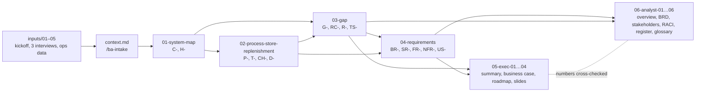

# Engagement overview (start here)

- **Engagement:** Harbour Lane Coffee Co. — Stock ordering review (`samples/coffee-chain`)
- **Date:** 2026-11-12
- **Mode:** `--no-questions`. Assembled from `context.md`, `inputs/` and outputs 01–04. No reader, review status or new decisions were confirmed with the user.
- **Sources used:** `context.md`; `inputs/01`–`05`; `outputs/01-system-map.md`, `02-process-store-replenishment.md`, `03-gap.md`, `04-requirements.md`; the exec pack `05-exec-01`–`04`.
- **Open questions:** all consolidated in [06-analyst-05](06-analyst-05-assumptions-decisions-register.md) (Q-01 to Q-43). Asked for this pack: who the reader is (Q-41) and the review status of each output (Q-43).

---

## 1. Summary
Harbour Lane Coffee Co. is a fictional practice case: 12 coffee shops, ~140 staff and ≈ $14M a year in revenue, growing to 17 stores by July 2027. This engagement reviews **stock ordering** from store order through to warehouse delivery, plus emergency top-ups and warehouse reorder points. Pastries, dairy, waste recording and invoice matching are adjacent, and their scope is `TBD`. The sponsor is **Priya Nair** (Operations Director).

**Goals:**
- halve core-item stockouts,
- cut recorded waste by 10–20%,
- scale to 17 stores with one coordinator,
- reduce manager paperwork.

**Status:** analysis complete to requirements, and the exec and analyst packs have been drafted. **Nothing has been validated with stakeholders yet.** Every output was produced with `--no-questions`. The next milestone is the leadership decision on 30 Nov 2026 (A-01) and a validation round with Mei, Daniel and a second store manager.

## 2. Deliverables map
Status key: *Draft (unvalidated)* = built from inputs only, not reviewed by stakeholders.

| File | Contents | Date | Status | Key IDs |
|---|---|---|---|---|
| `context.md` | Intake: company, goals, stakeholders, systems, processes, pain points, data, constraints, scope | 2026-11-12 | Draft (unvalidated) | A-01–A-03; 16 open questions |
| `inputs/01-kickoff-meeting-notes.md` | Sponsor goals, constraints, budget | 2026-10-20 | Source (read-only) | — |
| `inputs/02-interview-store-manager.md` | Daniel Okafor (Docklands) | 2026-10-23 | Source | — |
| `inputs/03-interview-warehouse-coordinator.md` | Mei Chen | 2026-10-24 | Source | — |
| `inputs/04-interview-finance.md` | Tom Reyes: waste, rates, budget | 2026-10-27 | Source | — |
| `inputs/05-ops-data-summary.md` | 12 weeks of stockouts, errors, couriers | 2026-08-03 → 10-25 | Source | — |
| [`outputs/01-system-map.md`](01-system-map.md) | Component and handoff inventory, health ratings, colour-coded map, focus list | 2026-11-12 | Draft (unvalidated) | C-01…C-23, H-01…H-27, Q-01…Q-12 (local) |
| [`outputs/02-process-store-replenishment.md`](02-process-store-replenishment.md) | SIPOC, as-is and to-be swimlanes, step table, metrics, change list | 2026-11-12 | Draft (unvalidated) | P-01…P-17, T-01…T-16, CH-01…CH-14, D-01…D-04, Q-01…Q-17 (local) |
| [`outputs/03-gap.md`](03-gap.md) | Target state, 20 gaps, 5 Whys, fishbone, SWOT, recommendations, roadmap | 2026-11-12 | Draft (unvalidated) | TS-1…TS-5, G-01…G-20, RC-01…RC-07, R-01…R-12, A-04…A-08, Q-01…Q-16 (local) |
| [`outputs/04-requirements.md`](04-requirements.md) | BR, SR, FR, NFR, user stories, acceptance criteria, MoSCoW, traceability | 2026-11-12 | Draft (unvalidated) | BR-01…07, SR-01…23, FR-01…59, NFR-01…28, US-01…35, Q-01…Q-20 (local) |
| [`outputs/05-exec-01-executive-summary.md`](05-exec-01-executive-summary.md) | One-page summary and the ask | 2026-11-12 | Draft | IDs in footnotes |
| [`outputs/05-exec-02-business-case.md`](05-exec-02-business-case.md) | Options 0/1/2, costs (TBD), benefits (estimates), payback ceiling | 2026-11-12 | Draft (not reviewed by Finance) | Options → R-IDs; A-07…A-29 |
| [`outputs/05-exec-03-roadmap-and-decisions.md`](05-exec-03-roadmap-and-decisions.md) | Now/Next/Later, KPIs, 9 decisions, risks | 2026-11-12 | Draft | D-01…D-05, R-IDs |
| [`outputs/05-exec-04-slide-outline.md`](05-exec-04-slide-outline.md) | 8-slide outline with action titles and speaker notes | 2026-11-12 | Draft | — |
| [`outputs/06-analyst-01-engagement-overview.md`](06-analyst-01-engagement-overview.md) | This file | 2026-11-12 | Draft | — |
| [`outputs/06-analyst-02-brd.md`](06-analyst-02-brd.md) | Consolidated BRD for sign-off, with extended traceability (BR → G → RC → R → CH → FR) | 2026-11-12 | Draft, awaiting sign-off | BR-, R-, CH-, FR- |
| [`outputs/06-analyst-03-stakeholder-map.md`](06-analyst-03-stakeholder-map.md) | Register, power/interest grid, engagement plan, conflicts | 2026-11-12 | Draft | — |
| [`outputs/06-analyst-04-raci.md`](06-analyst-04-raci.md) | RACI for roadmap items, components and sign-offs | 2026-11-12 | Draft (owners TBD) | R-, C-, D- |
| [`outputs/06-analyst-05-assumptions-decisions-register.md`](06-analyst-05-assumptions-decisions-register.md) | A-01…A-38, D-01…D-13, consolidated Q-01…Q-43 | 2026-11-12 | Live register | A-, D-, Q- |
| [`outputs/06-analyst-06-glossary-and-id-index.md`](06-analyst-06-glossary-and-id-index.md) | Glossary, ID prefix key, ID index | 2026-11-12 | Draft | all |

> **Q-ID warning:** each of outputs 01–04 numbers its open questions locally, so `Q-05` means something different in each file. In the analyst pack, **Q-IDs refer to the consolidated register (06-analyst-05)**, which maps each one back to its local source IDs.

## 3. Analysis flow

## 4. Key findings
1. **Stock rules have no owner** (RC-01). Par levels have been stale since 2024 and reorder points are known only to Mei (C-21, G-11, G-14). This is the main driver of stockouts (4.5/wk reported, BR-01) and of "just in case" over-ordering.
2. **Demand and stock data never reach the ordering decision** (RC-02). TillPoint sales (H-22) and warehouse availability are unused (H-23, H-24 missing; G-10).
3. **No standard order format**, so the existing StockPro import goes unused (RC-03). As a result ~480 lines a week are re-keyed by one person: 6–8 h a week and ~2.6 errors a week (H-03, P-06, G-03).
4. **There is a single point of failure and no end-to-end owner** (RC-07, RC-04). The August outage (G-01). Substitutions, delivery checks and late orders have no rules (G-04, G-05). "Nobody is accountable" (G-13).
5. **The baselines are weak and disputed** (RC-06). Stockouts are self-reported, and waste is $182k recorded vs ~$250k estimated (G-16, G-17). Pastries are ~$96k of the waste (G-19, RC-05), but their scope is `TBD`.

## 5. Status and next steps
| Status | Items |
|---|---|
| **Done (draft)** | Intake, system map, replenishment process, gap analysis, requirements, exec pack, analyst pack |
| **In progress** | Nothing. Waiting on stakeholder validation |
| **Not started** | Validation walk-throughs; `/ba-process` for pastry ordering (if in scope); requirements for a future warehouse system (after R-10); costing |

**Who to talk to next:**
1. **Priya Nair** (+ Tom for D-04), before 30 Nov: decisions 1–5 in [05-exec-03](05-exec-03-roadmap-and-decisions.md), pastry scope (Q-01) and waste baseline (Q-03).
2. **Mei Chen**: validate the system map and process (Q-19, Q-24, Q-25), the import format (Q-08), and choosing a backup (Q-20).
3. **Josh (IT)**, not yet interviewed: StockPro support, import/export, capacity Feb–Jun, security policy (Q-07, Q-08, Q-10, Q-11).
4. **A second store manager from a quieter store**, plus a picker and a shift lead: this tests whether Docklands is typical (Q-14, A-31).
5. **Tom Reyes**: review the business case estimates (A-26, A-27, Q-40).

## 6. How to continue
| Next skill | Why |
|---|---|
| `/ba-intake samples/coffee-chain` (in interview mode) | Close the 16 intake questions with Priya, especially scope, reporting lines and stakeholder attitudes |
| `/ba-process samples/coffee-chain pastry-ordering` | If pastries come into scope (Q-01). They are the largest waste item and have no process map yet |
| Re-run `/ba-gap` and `/ba-requirements` | After validation, so that confidence ratings and Musts reflect confirmed facts |
| `/ba-docs samples/coffee-chain exec business-case` | After quotes and 6–8 weeks of log data (from ~15 Feb 2027), to replace the TBD costs |
| `/ba-requirements` for the future warehouse system | After the vendor answers Q-07 (feeds R-10, BR-07) |

---

## Open questions
*(not asked — --no-questions)*. See the full register in 06-analyst-05.
- **Q-41** Who will read this pack: a new BA joining, a handover, or a peer review? This changes the level of detail.
- **Q-43** Have any outputs been reviewed with stakeholders? All are marked Draft (unvalidated) until confirmed.

## Next steps
1. Get the decision meeting with Priya before 30 Nov 2026.
2. Run the validation round (Mei, Daniel, a second manager, Josh) and update statuses in §2.
3. Keep the register (06-analyst-05) as the single source for assumptions, decisions and questions.

## Technique notes
- **Engagement overview.** A handover or overview doc is the BA's equivalent of a README. It saves the next person days of reverse-engineering. The deliverables map with "Key IDs" is the fastest way to find where any finding was defined.
- **Analysis flow diagram.** Showing which outputs feed which makes the impact of change visible. If the gap analysis changes, you know the requirements and both packs need a re-check.
