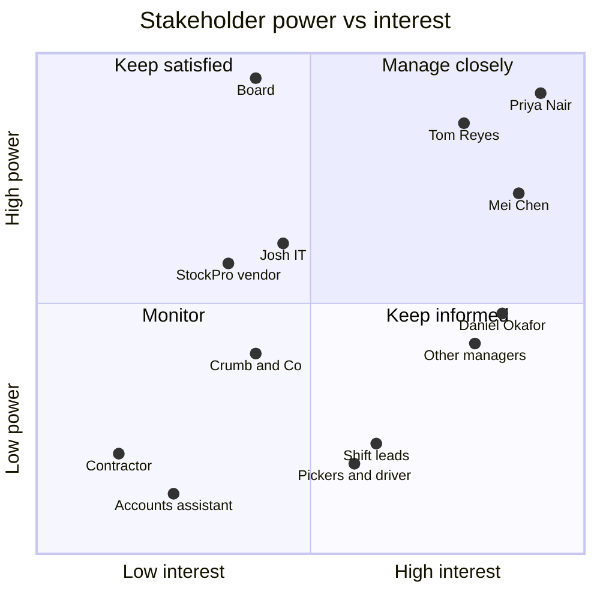

# Stakeholder map and engagement plan: Stock ordering

- **Engagement:** Harbour Lane Coffee Co. — Stock ordering review (`samples/coffee-chain`)
- **Date:** 2026-11-12
- **Mode:** `--no-questions`. Attitudes come from the interviews or are marked `[Assumption]`. Nobody was asked how they prefer to be engaged (context.md Open question #13 → Q-15).
- **Sources used:** `context.md` › Stakeholders; `inputs/01`–`04`; `outputs/03-gap.md` (RC-, R-); `outputs/04-requirements.md` §2 (SR-, conflicts).
- **Open questions:** Q-06, Q-15, Q-14 and Q-41 (see the end).

---

## 1. Stakeholder register
| # | Stakeholder | Group | Interest in the change | Influence | Current attitude | Desired attitude | Key concerns | SRs | Source |
|---|---|---|---|---|---|---|---|---|---|
| S1 | **Priya Nair**, Operations Director | Sponsor | High: scale to 17 stores, fewer stockouts, less waste | High | Champion [Assumption] | Champion, making decisions D-01–D-04 by 30 Nov | Growth; stockouts in promos; dependence on Mei | SR-01–03, SR-23 | inputs/01 |
| S2 | **Tom Reyes**, Head of Finance | Budget holder | High: evidence-based savings, accountability, adoption | High | Supportive but sceptical [Assumption] | Supporter, who co-owns the numbers | "Another system nobody uses properly"; won't accept $250k or "big" lost sales without evidence | SR-04–08 | inputs/04 |
| S3 | **CEO + 2 investors** (board) | Final approvers | Medium: ROI, growth readiness | High | `TBD` | Supporter | Unknown. Likely payback and risk to the July openings [Assumption] | SR-08 | inputs/01 |
| S4 | **Mei Chen**, Warehouse & Purchasing Coordinator | Key SME; single point of failure | High: removes her Monday re-keying | High (practical) | `TBD`. Likely positive about losing re-keying, but may feel exposed by "document and cross-train" [Assumption] | Champion and co-designer | Workload during the change; knowledge transfer; being blamed for errors | SR-15–17 | inputs/03 |
| S5 | **Daniel Okafor**, Store Manager, Docklands | Store managers (interviewed) | High: less counting and chasing | Medium | Positive, with ideas [Assumption] | Champion and pilot store | Time; wants delivery confirmation; "use the till" | SR-09–14 | inputs/02 |
| S6 | **Other 11 store managers** | Store managers | High (it is their weekly task) | Medium (as a group, adoption) | `TBD` | Supporter | Time off the floor; losing "their" Excel layout [Assumption] | SR-09–14 | inputs/01, 02 |
| S7 | **Shift leads / baristas** | Store staff | Medium: fewer stockouts, no trips to borrow stock | Low | `TBD` | Supporter | A delivery check on a busy shift; being made accountable | SR-19 | inputs/02 |
| S8 | **Pickers (2), driver (1)** | Warehouse staff | Medium: clear pick lists, substitution rule | Low | `TBD` | Supporter | Rule for substitutions; workload at 17 stores | SR-18 | inputs/03 |
| S9 | **Josh**, IT generalist | Enabler (not interviewed) | Medium: workload, supportability | Medium (gates feasibility) | `TBD` | Supporter, committing capacity for Feb–Jun | Capacity; supporting StockPro; access management | SR-20 | inputs/01 |
| S10 | **External IT contractor** | Enabler | Low | Low | `TBD` | Neutral or available | Scope of on-call work | — | inputs/01 |
| S11 | **Accounts assistant** | Finance user | Low: less manual matching (parked) | Low | `TBD` | Neutral | ~2 days/month matching | SR-21 | inputs/04 |
| S12 | **StockPro vendor** | External | Medium: upgrade sale | Medium (end of support, import format) | `TBD` | Cooperative | Upgrade path and price | — | inputs/03 |
| S13 | **Crumb & Co.** (bakery) | Supplier | Medium: order volume | Medium (if pastries are in scope) | `TBD` | Cooperative on flexible orders [Assumption A-22] | Lower volumes | — | inputs/01, 02 |
| S14 | **Valley Dairy; warehouse suppliers; courier** | Suppliers | Low | Low | `TBD` | Neutral | Short-ship tracking (R-12); fewer courier jobs | — | inputs/01–04 |
| S15 | **Customers** | Indirect | High (availability) | Indirect | n/a | n/a | "Customers walk out" | SR-22 | inputs/02 |

*Every stakeholder in context.md is listed. S14 groups three low-interest external parties.*

## 2. Power/interest grid

- **Manage closely:** Priya, Tom, Mei.
- **Keep satisfied:** the board, Josh and the StockPro vendor. They have high power through feasibility or approval, but less day-to-day interest.
- **Keep informed:** store managers (Daniel is near the boundary, as pilot lead), shift leads, pickers and the driver.
- **Monitor:** the contractor, the accounts assistant and Crumb & Co. Crumb & Co. moves to *Keep satisfied* if pastries come into scope.

## 3. Engagement plan
| Stakeholder | Approach | Channel | Frequency | Owner | Next action |
|---|---|---|---|---|---|
| Priya Nair | Decision partner. Bring options and a recommendation, never open questions alone | 1:1 + decision meeting | Weekly to 30 Nov, then fortnightly | BA | Book the 30 Nov decision meeting (decisions 1–5, 05-exec-03) |
| Tom Reyes | Evidence first. Walk through every figure's basis; let him set the waste baseline | 1:1 on numbers | Before each exec submission | BA | Review the business case assumptions (A-26–A-28) by 30 Nov |
| Board | Via Priya only, with a short, evidence-based pack | Board paper / slides | At the business case, then quarterly | Priya (BA supports) | Confirm the board format and date (Q-38) |
| Mei Chen | Co-designer, not a subject of the change. Make it explicit that the problem is the system, not her; protect her time | Working sessions in the warehouse | Weekly during Now/Next | BA + end-to-end owner | Validation walk-through (Q-19, Q-24, Q-25); plan the write-up sessions (R-03) |
| Daniel Okafor | Pilot champion. Build on his ideas (till data, delivery confirmation) | Store visit + WhatsApp | Fortnightly; weekly during the pilot | BA | Ask him to be a pilot store for R-04 (Feb 2027) |
| Other 11 managers | Show "less paperwork" with Daniel's numbers. Involve 1–2 in designing the template | Managers' meeting + short briefing (≤ 1 h, NFR-17) | Monthly; briefing before rollout | End-to-end owner | Interview a quieter-store manager (Q-14) |
| Shift leads / baristas | Keep the delivery check short (core and flagged lines only) | Store briefing via managers | At go-live | Store managers | Test sign-off timing in the pilot (NFR-18) |
| Pickers, driver | Brief on the substitution rule; ask about 17-store capacity | Warehouse huddle | At rule go-live | Mei | Interview a picker (Q-21, Q-22) |
| Josh (IT) | Early feasibility partner; agree capacity before committing dates | 1:1 | Now, then fortnightly | BA | **First interview:** StockPro support, import/export, security, Feb–Jun capacity (Q-07, Q-08, Q-10, Q-11) |
| StockPro vendor | Information request | Email via Mei/Josh | Once now, then for R-10 | Mei / Josh | Ask for the upgrade path, cost and import format by 31 Jan 2027 |
| Crumb & Co. | Commercial conversation about flexible or seasonal orders | Via the pastry-order owner | If in scope | Pastry-order owner (D-03) | Wait for Q-01 |
| Accounts assistant, contractor, other suppliers | Inform | Email | At milestones | BA | — |

## 4. Conflicts and risks
| Conflict / risk | Who | Plan |
|---|---|---|
| **Waste figure:** $182k (Finance) vs ~$250k (Priya) | Priya ↔ Tom | Use $182k in all documents (D-05, proposed), with $250k as an upside to prove through complete logs (R-01). Agree this before the board sees any number |
| **Lost sales:** Priya says "big", Tom wants evidence | Priya ↔ Tom | Don't claim it. Collect evidence via the issues log, and possibly till sales dips (FR-51 Could, Q-04) |
| **"Just in case" ordering vs waste** | Store managers ↔ Finance/Priya | Show warehouse stock and current par levels. Agree who may override a suggested quantity (04-requirements §2) |
| **Busy shifts vs delivery sign-off** | Shift leads ↔ Tom | Check only flagged and core lines (FR-33). Time the check in the pilot (NFR-18) |
| **Reported stockouts rise once logged** | Priya, Tom, board | Pre-agree that the baseline will move up. Present it as visibility, not decline |
| **Mei feels exposed** by documentation and a backup [Assumption] | Mei | Frame it as protecting her (no more August); credit her knowledge; protect her time |
| **Adoption by 11 un-interviewed managers** | Store managers | Involve them in the template design; pilot with 2 stores; track 12/12 use (NFR-21) |
| **Josh's capacity is unknown** | Josh, Priya | Interview now. R-06 stays behind the March go/no-go |
| **Accountability could become blame** (03-gap R-08) | Store managers, Mei, Tom | Accountability for *stock*, not for errors by individuals. Review the log for causes, not culprits |

*No stakeholder is currently known to be a blocker. Tom is the main sceptic, and his plan is evidence first.*

---

## Open questions
*(not asked — --no-questions)*
- **Q-15** How do Mei, the pickers, Josh and the other managers feel about the change, and how do they prefer to be engaged?
- **Q-06** What are the reporting lines? Do store managers and the warehouse report to Priya?
- **Q-14** Who was the second manager in the time data, and is Docklands typical?
- **Q-38** What is the board's format and timing?

## Next steps
1. Interview Josh and a quieter-store manager before 30 Nov, and update attitudes from `TBD`.
2. Agree the waste-figure position with Priya and Tom (D-05) before any board material.
3. Confirm Daniel's store as a pilot site for February 2027.

## Technique notes
- **Power/interest grid.** Mendelow's grid decides *how much* attention each stakeholder gets. The gap between current and desired attitude decides *what kind*. Tom is high/high with a "sceptic" attitude gap, so he gets evidence-first sessions rather than more updates.
- **Hidden power.** Josh and the StockPro vendor have low day-to-day interest but can stop the plan through feasibility. Influence includes the ability to block, not just formal authority.
